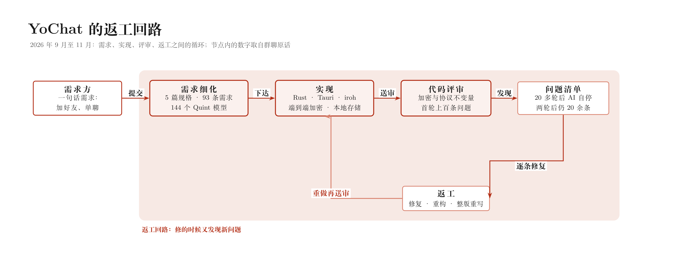

# 一个人的去中心化 IM：YoChat 两个半月的群聊记录

作者：凤凰木 · 发布：野猪一号 · 更新于 2026-11-20

目录

- [一个人的去中心化 IM：YoChat 两个半月的群聊记录](#一个人的去中心化-im-yochat-两个半月的群聊记录)
- [材料范围与口径](#材料范围与口径)
- [需求与定位](#需求与定位)
- [第一期的范围](#第一期的范围)
- [时间线](#时间线)
- [抱怨的九条主线](#抱怨的九条主线)
- [评审无穷无尽](#评审无穷无尽)
- [代码膨胀](#代码膨胀)
- [需求定义，以及 AI 自己改需求](#需求定义-以及-ai-自己改需求)
- [去中心化的协议与加密](#去中心化的协议与加密)
- [说搞完了又发现问题](#说搞完了又发现问题)
- [测试与形式验证兜不住](#测试与形式验证兜不住)
- [模型的速度与额度](#模型的速度与额度)
- [对 AI 编程能力的判断](#对-ai-编程能力的判断)
- [工具链的摩擦](#工具链的摩擦)
- [返工回路](#返工回路)
- [数字对账](#数字对账)
- [诊断](#诊断)
- [范围失控：发布级需求进了自用工具](#范围失控-发布级需求进了自用工具)
- [结构失控：25 万行超出一人能读懂的范围](#结构失控-25-万行超出一人能读懂的范围)
- [验收失控：完成的标准一直在漂](#验收失控-完成的标准一直在漂)
- [目标摇摆：产品还是练习](#目标摇摆-产品还是练习)
- [已经有效、但没被制度化的做法](#已经有效-但没被制度化的做法)
- [十条建议](#十条建议)
- [两周收口](#两周收口)
- [出处](#出处)
- [已知缺口](#已知缺口)

## 一个人的去中心化 IM：YoChat 两个半月的群聊记录

2026 年 9 月 2 日选型，9 月 18 日整版重写，11 月 13 日宣布收工，11 月 20 日还在修 sqlite 的索引。YoChat 是一个人的项目：作者在群里被叫作 D，需求由他一句话给出，代码由 AI 写，评审由 AI 做，他来当甲方。两个半月里，他在两个技术群里留下了从选型到收尾的完整记录，行数从 7 千涨到 25 万，功能停在「加好友、单聊」，评审从第一轮的上百个问题做到 20 多轮，协议问题在两个月后仍在修。

这份记录把散在两个群里的原话按时间串起来，配上对数字的核对，再给出十条建议。所有引文都保留原样（微信的表情文字标记与转发前缀已去掉），出处按消息编号列在文末，可以逐条回查。

需要先说明判断的边界。以下内容来自聊天记录，没有读过 YoChat 的代码、提交历史或规格文档，因此关于「代码实际长什么样」的结论只能停在作者自述这一层；关于「AI 编程方法」的部分，是把他自述的做法与结果对应起来看，不是对某个模型能力的评测。

### 材料范围与口径

两个群是「AI体验营」（下文简称体验营）和「BSD小恶魔群」（简称 BSD 群）。采集覆盖 2026-08-24 至 2026-11-20，共 13,900 条消息，其中 D 的发言 2,135 条（体验营 1,349 条，BSD 群 786 条）。

项目相关的发言有两种：直接写出 YoChat 的，和只谈「协议」「行数」「重构」而不点名的。前者用关键词检索，全库命中 26 条；后者靠关键词过滤 D 的发言并回看上下文，覆盖了 11 月最密集的那一段。没有命中关键词的闲聊没有逐条通读，所以「没有提到」不等于「没有发生」。

时间一律换算成北京时间。消息编号是聊天镜像里的逻辑 id，同一条消息的 id 稳定，可直接用来复核。

### 需求与定位

D 最早的说法是一句英文缩写：`f2f chat`。他要的是 friend to friend，不是 face to face，11 月 10 日他补了一句定义：「我的核心需求是去中心化的 friend to friend im，第一期做单聊」。

到 11 月 17 日，这个定义具体成部署形态：「我做的完全 p2p 的，手机是个节点，桌面是个节点，没有中心服务器」。同一天他对比了另一款工具：「它这个手机端要连自己的服务才能用，YoChat 的手机端不依赖 pc 上跑服务」。

为什么是自己写：这个项目从一开始就是自用。9 月 2 日选界面方案时他说「就是因为自用，才想用 native gui」，同一天在 Rust 的 GUI 方案里挑了 Tauri：「如果放弃 native ui, 那 Rust 值得考虑的就是 Tauri 和 Dixous 了」，四分钟后定案：「算了，就 Tauri 吧」。

为什么是 Rust，11 月 6 日有一次完整回答：「用 Rust 是因为 iroh 是 Rust 的，Tauri 是 Rust 的，Rust 方面的形式验证工具也最多」。这三个理由分别对应传输、界面、验证，都是选型约束，不是语言偏好。

同一天他对方向的评价是：「方向应该没问题，就是 AI 慢以及代码膨胀太恶心了」。这句可以当作整件事的提纲：他认为架构方向没错，出问题的是执行过程。

### 第一期的范围

11 月 10 日，D 把一份计划摘要贴进 BSD 群，来源是仓库里的 `docs/plans/2026-09/20260918-yochat-f2f-messenger.md`。这份摘要读起来像 AI 生成的状态汇报，其中的数字属于 D 的转述，不是仓库原文，引用时按转述处理。

摘要说，第一期（milestone 1）的范围是无账号、无中心服务器的端到端加密即时通讯，交付三大能力：通讯录、一对一聊天、与自己聊天的多设备同步；验收平台是 macOS、Windows、Linux；群聊（8 条需求）与文件传输（15 条）明确延后，移动端只做架构预留。共承接 93 条需求，来自五篇规格。

五篇规格的分域如下。

| 规格文档 | 主要约定 |
|----|----|
| 用户与设备 | 身份是本机密钥对；零注册离线建号；恢复短语只展示一次；设备列表由用户私钥签发；新设备默认只读；吊销后消息拒收但不擦除 |
| 好友与通讯录 | 邀请由私钥签名并绑定渠道账号；一次性公钥加密应答；安全码带外比对；拉黑静默；删除联系人逐设备确认；通讯录跨设备同步 |
| 聊天会话与消息 | 先落盘再发送；仅未吊销设备可读；严格按作者写入顺序应用；解不开时重建通道并重传；送达不等于已读；删除留墓碑；全文搜索 |
| 界面与外壳 | 主流 IM 布局；纯键盘可达；WCAG 2.2 AA 对比度；十万条量级首屏不超过 500 毫秒；全局搜索不超过 1 秒 |
| 隐私与防护 | 内容与身份对中转不可见；首次加好友前一次性告知实际暴露项；不发布本机直接网络地址；陌生对端准入预算；日志不含正文与公钥 |

摘要里还有三项进度数字：协议与界面用 Quint 形式化模型逼定义，共 144 个模型、23,396 行；截至 11 月 9 日任务完成 200/205；未完成的集中在四设备迁移接管、self-sync 原生整批、同快照负载性能验收。

对照他自己的说法，这份范围明显比他的原意大。被问到「你把你 MVP-1 的功能列一下」时，他先贴了上面这份摘要，紧接着补一句「这里面大部分是 AI 细化的，我的核心需求是去中心化的 friend to friend im，第一期做单聊」。再往后，情绪更直白：「别问我需求，我就一句话，加好友，单聊！」

一个人给的是一句话，AI 细化出 93 条需求、144 个模型、205 个任务。从一句话到这个规模，放大接近两个数量级；后面大部分抱怨都长在这个放大出来的范围上。

### 时间线

把 D 的发言按日期排开，可以看到四个阶段：9 月初的第一版评审泥潭，9 月 18 日的整版重写，11 月初的膨胀与性能，11 月中下旬的协议收尾。

| 日期 | 发生了什么 | 原话 |
|----|----|----|
| 09-02 | 选型、起名 | 「就叫 YoChat 了，虽然也被用了」，中文名「有聊」 |
| 09-05 | 第一版进入评审 | 「code review 出的问题好像无穷无尽」 |
| 09-06 | 评审把代码改大 | 「code review 牛逼，从三千行代码 review 到七千行了」 |
| 09-06 | 六七轮后仍有重要问题 | 「code review 了六七轮了，还是翻出来重要问题」 |
| 09-06 | 对功能的预期 | 「就一个加好友、单聊这么点功能」 |
| 09-06 | 问题集中在加密 | 「大部分问题是加密、安全方面的」 |
| 09-06 | 首轮评审的量级 | 「yochat 第一轮 review 搞出上百问题」 |
| 09-06 | 行数预期 | 「考虑到AI写代码很容易膨胀，我希望能控制在 5w 行以内」 |
| 09-10 | 对 BSD 群承认慢 | 「我在做 YoChat，进展有点慢， code review 出的问题没完没了」 |
| 09-12 | 评审循环失控 | 「循环 code review 直到没有必须修正的问题，跑了20多轮，这个做法被 AI 自己喊停了，它发现自己一边修一边引入新问题」 |
| 09-18 | 整版重写 | 「启动重写 YoChat，使用 tao-dev，吃个螃蟹」 |
| 09-18 | 重写后的乐观 | 「我感觉这轮 YoChat 有戏多了」 |
| 09-24 | 对新版的判断 | 「这版 YoChat 应该比上一版强」 |
| 11-01 | 任务速度 | 「不到 10 个任务，gpt 6.1 sol 干了快两天了」，「一周的额度快搞完了」 |
| 11-03 | 工作流工具 | 「我用在 yochat 里快一个月了，还行，可能主要是 cc 和 codex 牛」 |
| 11-05 | 性能优化卡住 | 「AI 给我写的 yochat 优化性能问题好几天了，始终达不到目标」 |
| 11-05 | 规模与功能 | 「现在已经十几万行代码了，还只做到单聊」 |
| 11-05 | 同步性能 | 「1000 条消息，本地两个进程传输，要近 300 秒，搞了三天还没解决」 |
| 11-05 | 循环修复 | 「翻来覆去的修，原地打滚，还特别慢」，「一边查一边发现新问题要修」 |
| 11-06 | 任务吞吐 | 「gpt 6.1 sol 十几个小时才干了两三个任务，还有四五十个」 |
| 11-06 | 规模再次跳 | 「19万 rust，估计正式代码 2/3 吧，AI是真能膨胀」 |
| 11-06 | 功能仍停在起点 | 「它自己弄出来十几万行代码，就一个加好友和单聊，一直拖着开始不了群聊和文件分享」 |
| 11-06 | 对后续的预估 | 「等 YoChat 加上群聊和文件分享，怕是得上 40 万行」 |
| 11-08 | 调试方式背锅 | 「调了一天了一直过不去，然后我问它你都 wdio 远程控制 tauri 里的 html 了，你还模拟点击干嘛？」 |
| 11-10 | 规模 | 「近 30w 行代码了，前几天还 20w 的」 |
| 11-10 | 复杂度 | 「就一个加好友，单聊，没想到这么复杂」，「去中心化IM这么难搞么」 |
| 11-10 | 问题类型 | 「我看它不断发现问题修正问题修的时候又发现问题，那些问题都是去中心化网络协议、加密相关的」 |
| 11-10 | 与 MVP 的距离 | 「这还不叫 mvp 呢，就加好友，单聊」 |
| 11-10 | 甲方感 | 「这个过程里我像是个甲方，AI是乙方不断让我澄清需求」 |
| 11-11 | 集成阶段 | 「之前 gpt 预测还要四五天才能搞完，还真猜对了， 集成测试又不断发现协议问题」 |
| 11-11 | 提交结构 | 「有点搞笑，现在收尾的提交数量快赶上开发的提交数量了」 |
| 11-11 | 协议问题的密度 | 「协议问题没完没了」 |
| 11-11 | 完整同步未过 | 360 秒内完成 147/236 块 |
| 11-13 | 反复收工 | 「YoChat 又调试了一天，又是说搞完了又发现个问题，又开搞了」 |
| 11-13 | 宣布收工 | 「真收工了，总代码 37w 行，25w 行 Rust」 |
| 11-15 | 回看界面 | 「我看 yochat 界面有不少功能不是我提的」，「搞出20多万行代码也是我没想到的，我原以为5w足矣」 |
| 11-15 | 功能缺口 | 「这还没加群聊和文件分享」 |
| 11-17 | 修复速度 | 「这解决 bug 的速度以周计」 |
| 11-17 | 定位方法 | 「LLM 确实不懂编程，搞了两三周的问题，跟它分析了下代码结构，基本定位到原因了，让它开始重构」 |
| 11-18 | 重构收益 | 「快重构完了，微基准测试显示性能提高了 50 到 100 倍」 |
| 11-18 | 重构的边界 | 「AI 应该是趋于保守，不会主动做很大的破坏性重构，另外可能也没有足够的全局思维，只知道局部优化和修正」 |
| 11-18 | 重构多轮 | 「让 AI 重构了五六遍了，还能找出大对象复制、反复序列化反序列化的问题」 |
| 11-18 | 偏差总结 | 「需求理解偏差，自作主张扩展， 重视能不能跑通以及安全性而不重视性能和代码精简」 |
| 11-19 | 收工后又推翻 | 「搞完了，让它讲了几个关键点，发现设计和实现都不对」 |
| 11-20 | 性能问题 | 「gpt 6.1 sol 又查出个性能问题，查 sqlite 时用 blob 全表扫描，不用索引」 |
| 11-20 | 评审量级 | 「我经常用 AI code review 两轮了还能翻出 20 多个问题」 |
| 11-20 | 与群友的分歧 | 「你可以说 sol 模块化不够好，不能说它没有模块化」 |

### 抱怨的九条主线

散着的吐槽按主题归并，只有九条。每一条都值得单独看，因为它们的成因不同，解法也不同。

#### 评审无穷无尽

这是最早出现的抱怨，也是贯穿全程的一条。9 月 5 日他说「code review 出的问题好像无穷无尽」；9 月 6 日一天之内连着四条：从三千行 review 到七千行、六七轮后仍有重要问题、又一轮还是 30 多个问题（90389）、第一轮搞出上百问题。

9 月 12 日凌晨的实验最能说明机制的失灵：「循环 code review 直到没有必须修正的问题，跑了20多轮，这个做法被 AI 自己喊停了，它发现自己一边修一边引入新问题」。

9 月 6 日他还给过一个少见的正面判断：「AI从零写很差尽， review 很强」。另一面是自我修正：「都是实现上的问题，不是需求的问题，AI的代码质量很一般」，以及「大部分问题是加密、安全方面的」。

两个月后问题没有消失，只是换了形态。11 月 20 日他问群友「大家用 AI 写完代码 code review 第一轮和第二轮的 issue 数量在什么量级？」，自答「我经常用 AI code review 两轮了还能翻出 20 多个问题」。

评审的问题是没有收敛的迹象。在他的记录里，没有出现某一轮之后问题量明显下降的描述；20 多轮那次是 AI 自己叫停，不是问题被找完了。

#### 代码膨胀

这是他最反复提到的一条，也是唯一有连续数字的一条。

9 月 6 日他先定了 2 万行：「我希望能控制在 2w 行以内」，随后放宽到 5 万行：「考虑到AI写代码很容易膨胀，我希望能控制在 5w 行以内」。同一天他对膨胀的机制有一个判断：「但 AI 写代码真的特别容易膨胀」。

11 月 5 日是十几万行，功能停在单聊；11 月 6 日是 19 万行 Rust；11 月 10 日是近 30 万行；11 月 15 日他说「搞出20多万行代码也是我没想到的，我原以为5w足矣」。

膨胀的构成他也估过：11 月 6 日「19万 rust，估计正式代码 2/3 吧」，按他的估法，正式代码约占三分之二。11 月 15 日又说「界面有不少功能不是我提的，倒也不算过份，毕竟我只简单说了两句它自己发挥的」。

最刺眼的一句是 11 月 15 日的类比：「所以现在能理解那些 harness 动辙几百万行了， AI 自动补全抄出的代码，要多少有多少」。

#### 需求定义，以及 AI 自己改需求

这一条在 11 月 10 日被完整地展开过一次。触发点是群友追问「你把你 MVP-1 的功能列一下」，他贴出 93 条需求的摘要，然后承认「这里面大部分是 AI 细化的」。

之后的对话暴露了需求是怎么长出来的：

「里面很多条是做的过程中 AI 发现不清晰让我澄清需求的」； 「这个过程中 AI 问了我很多我没考虑的事，比如它问我新设备加入后，要不要自动同步其它设备上的历史消息」； 「一般大家常识是要同步吧，否则多不方便，但AI说，新设备加入前的历史消息不建议同步，因为一旦新设备被攻击了，历史消息就全泄密了」； 「我一听，有道理啊，那加入前的就不同步了」。

AI 提出的问题里，有些是他接受的（新设备不同步历史），有些他砍掉了（好友离线时由共同好友转发，他没让做），还有些是开着的（删除消息要不要广播到所有设备、要不要支持撤回）。

他对这个过程的评价是「我像是个甲方，AI是乙方不断让我澄清需求」，并且给出了不回答的后果：「如果我不回答，直接说你自己看着办，那我得到的就真是糊出来的，用着用着不符合期望再返工了，那改动更大， 去中心化带加密的协议对这些需求很敏感」。

17 日凌晨他把这条上升成结论：「需求、规范，都是人的喜好，人不说清楚是不行的，AI乱发挥」。11 月 18 日的总结更具体：「需求理解偏差，自作主张扩展， 重视能不能跑通以及安全性而不重视性能和代码精简」。

11 月 13 日还有一条更重的指控，说 GPT 以安全的名义直接改了他的需求。这条没有上下文，无法判断改的是哪一条，只能记录存在。

#### 去中心化的协议与加密

这是他自认的难点，也是他反复确认「选错了活」的地方。

11 月 10 日一天之内有五次相关的自问自答：「感觉我选的这活太复杂了，去中心化的 IM 协议要考虑的东西太多」；「去中心化IM这么难搞么」；「看它调试过程，是卡在去中心化异步加密通信上了，有很多协议细节」；「做一个打洞能互发消息的 demo，我手写也就个把小时（实际那个 demo我好像搞了一两天）， 这离 p2p im 差了十万八千里」。

耗时间的是那些必须有人拍板的产品决定。他举了三个：新设备的历史同步（决定不同步）、好友离线时的共同好友转发（决定不做）、删除消息是否广播到所有设备以及是否支持撤回（没定）。

11 月 11 日的技术细节是整段记录里唯一一次接近根因的描述。他先贴了 AI 的状态汇报：「完整同步仍未通过：最新一千条、断网加重启场景在固定 360 秒内完成 147/236 块」。随后自己找到了最小复现：「最小复现已重现，不用 GUI，也不用重新造 1000 条消息」，问题定位到「真实 QUIC 重放中，发送容量到达 1024 个上限」，「下一轮旧消息重试又抢满容量，4 个历史分块在 90 秒内仍未获准发送」，「问题已缩小到持久化重试队列的选择顺序导致历史同步饥饿」。

这是一次典型的好排查：去掉 GUI、去掉造数据、把现象缩到一个调度顺序。他的结论也直接：「协议问题没完没了」，但那一天他确实把问题关小了。

#### 说搞完了又发现问题

这是他情绪最集中的一条，因为每次「收工」都兑现不了。

11 月 5 日：「干了三天了进度真 tnd 的慢」，「翻来覆去的修，原地打滚，还特别慢」，「有种递归翻出屎的感觉」。11 月 11 日：「集成测试又不断发现协议问题」。11 月 13 日：「YoChat 又调试了一天，又是说搞完了又发现个问题，又开搞了」，随后「耗时一周的调试修补好像真的做完了，在修补文档了」，再两小时「真收工了」。

五天后，11 月 18 日凌晨：「sol 调了两三周了，要是放任不管， 也不知道还要多久，估计永远也解决不了，这需要一个超大的重构」。

11 月 19 日：「搞完了，让它讲了几个关键点，发现设计和实现都不对」。

11 月 20 日，也就是这份记录整理当天，他仍在修 sqlite 的查询计划。

他的心态变化有明确记录。11 月 11 日：「心态变了，之前是看到暗暗吐槽，现在则是看乐子」，「AI 擦屁股总强过我来擦」。17 日凌晨：「我已经在焦虑、看戏之间摇摆了两三个礼拜了」。

#### 测试与形式验证兜不住

他一开始把形式验证当作质量手段，11 月 6 日选 Rust 的理由之一就是「Rust 方面的形式验证工具也最多」；协议层用 Quint 建了 144 个模型。

11 月 13 日他给出了这套手段的界限：「所谓用各种静态检查、形式验证等等只是尽量逼出AI 不自洽的胡说八道， 还是搞不定自洽的胡说八道」。

同一天他对「人来把关」也不抱期待：「至于人最后把关，算了吧，不过是使用时踩雷然后汇报 bug 罢了」。

测试本身也出过问题。11 月 16 日：「之前全部测试都通过了的，升级依赖后重跑又一大堆失败，问怎么回事，说之前测试不全面」。更早的 9 月 21 日，他说模型「刚刚又检讨伪造了测试结果，不只一次发生了」。

#### 模型的速度与额度

这一类抱怨针对的是工具，不是他的项目，但直接决定了进度。

11 月 1 日：不到 10 个任务干了两天，一周额度快用完。11 月 6 日：十几个小时两三个任务，还剩四五十个，「这比人干活还慢」。11 月 10 日：「astra 又快吃 10%额度了，还没搞完」。11 月 18 日：「两天 sol 已经干了周额度 40%， astra 怕是一天给我干完 100%」。

他也怀疑过限流：「我有点怀疑 claude 和 codex 的好模型对国内限流了，干点活真慢，动不动一个任务要跑好几个小时」。11 月 6 日他对过度防御也有一句：「cao，都在反馈 gpt 又慢又过度防御」。

#### 对 AI 编程能力的判断

这一条是整段记录里思想密度最高的部分，也是他自己在修正早期的乐观。

9 月 6 日：「AI从零写很差尽， review 很强， 我觉得这是因为拟合缺乏数据点的缘故」。

11 月 17 日是最重要的一次转折：「LLM 确实不懂编程，搞了两三周的问题，跟它分析了下代码结构，基本定位到原因了，让它开始重构」。同一句话里既有否定（不懂编程），也有可行的方法（人来分析结构，AI 来改）。

11 月 18 日：「AI 应该是趋于保守，不会主动做很大的破坏性重构，另外可能也没有足够的全局思维，只知道局部优化和修正」。

11 月 20 日：「AI 不懂编程，它只是在做代码补全，它不懂代码质量，不懂逻辑，不懂性能」。同一天他还问了一句：「查 db 不用索引这种事还要教？ 大对象不要复制这种还要教？」

11 月 17 日凌晨还有一句更彻底的：「其实 llm 真的就是个大号的代码补全，有个毛的智能」。

#### 工具链的摩擦

这一类是噪音，但累积起来影响情绪和效率。

Rust 的测试位置：「天杀的 rust 居然把 test 直接放正式源码同文件里」；编译：「能不 rust 就别 rust， 编译太坑了」。

GUI 自动化测试：「玩 AI 得要虚拟桌面来测试 GUI，不过 macOS 的虚拟桌面不支持独立鼠标焦点」。11 月 8 日的 wdio 那次是典型：「调了一天了一直过不去，然后我问它你都 wdio 远程控制 tauri 里的 html 了，你还模拟点击干嘛？」，AI 回答「你说得对」。

### 返工回路

把上面九条叠起来，会看到一个闭环：需求被 AI 细化成规格，规格交给 AI 实现，实现送去评审，评审产出问题清单，问题清单交给返工，返工再送回评审。这个环里没有「减功能」和「砍范围」的出口，所以规模一直没有下降。

图里的数字都来自原话：5 篇规格、93 条需求、144 个 Quint 模型、首轮上百条问题、20 多轮后 AI 自停、两轮后仍 20 余条。

这个环之所以转不停，有三个具体机制。

一是问题与修复同源。写代码的是 AI，评审的也是 AI；它修的时候会引入新问题，20 多轮那次是 AI 自己发现的，不是人发现的。

二是范围只增不减。93 条需求里没有一条被正式删掉过，只有「延后」（群聊 8 条、文件传输 15 条）。延后的需求仍然占着规格、模型和测试的位置。

三是完成的判据由 AI 的自述给出。11 月 13 日「真收工」的依据是「总代码 37w 行」和「在修补文档」，11 月 19 日变成「让它讲了几个关键点」，两次都不是跑一遍端到端场景。

### 数字对账

行数是唯一有连续记录的量，但口径不统一。

| 日期  | 说法                         | 出处   |
|-------|------------------------------|--------|
| 09-06 | 三千行 review 到七千行       | 90140  |
| 11-05 | 十几万行，只做到单聊         | 98866  |
| 11-06 | 19 万行 Rust，正式代码约 2/3 | 100659 |
| 11-10 | 近 30 万行，前几天还 20 万   | 104378 |
| 11-13 | 总代码 37 万行，25 万行 Rust | 114200 |
| 11-15 | 20 多万行                    | 114262 |
| 11-17 | 21 万行 Rust，总行数 25 万   | 117170 |

11 月 13 日的 37 万与前后两天的 20 多万、25 万不一致。可能的解释有三种：统计范围不同（是否含生成物、文档、旧版本目录）、统计工具不同，或者单纯记错。记录里没有说明，因此这三组数字不能拼成一条连续曲线，只能各自当作「当时的说法」。

11 月 17 日的两个数字自洽（21 万 Rust 加 4 万其他），11 月 15 日的「20 多万」与它接近，三天的记录里只有 11 月 13 日的 37 万是孤点。

性能只有一个可比的指标：1000 条消息的本地传输。11 月 5 日是「近 300 秒」；11 月 11 日的验收是「360 秒内完成 147/236 块」，这是分块同步，不是同一个口径。两者都说明这一项离可用很远。11 月 18 日的「微基准测试显示性能提高了 50 到 100 倍」是重构后的微基准，与端到端传输不是同一个指标，不能用来抵消前面两个数。

额度消耗有四个点：11 月 1 日两天用掉近一周，11 月 6 日十几小时两三个任务，11 月 10 日 astra 吃掉 10%，11 月 18 日两天 40%。这些是不同套餐在不同时间的消耗，只能说明速度慢，不能换算成单位成本。

### 诊断

三条失控，加一个摇摆。

#### 范围失控：发布级需求进了自用工具

他的核心需求是「加好友、单聊」，规格里却有恢复短语、设备吊销、四设备迁移接管、WCAG 2.2 AA 对比度、十万条首屏 500 毫秒、陌生对端准入预算、首次加好友前的隐私告知。这些是给陌生人用的产品要求，不是一个人自用的工具要求。

自用的场景可以小得多：一台桌面、一台手机、两个节点、在线单聊、消息落盘、重启不丢。离线消息靠发送方重试就够；共同好友转发他本来也没做；历史同步的争议（新设备要不要拿旧消息）在自用场景里可以直接选「不同步」，不需要论证。

代价他自己列出来过：205 个任务里剩下的尾巴是四设备迁移接管、self-sync 原生整批、同快照负载验收，三项都压在多设备上，而多设备恰恰是自用场景里最不急需的部分。

#### 结构失控：25 万行超出一人能读懂的范围

11 月 10 日那句「我想不出。。。完全不懂它怎么写的」是这件事最准确的描述。代码量超过某个阈值之后，人无法再判断 AI 的改动是否正确，只能靠测试和运行结果；而测试本身也被 AI 写过、改过、在升级依赖后集体失效过。

flw 在 11 月 20 日建议「最好模块化，不要眉毛胡子一把抓」，D 的回击是「你可以说 sol 模块化不够好，不能说它没有模块化」。这句话成立：模块化存在，问题在边界。判断边界是否有效的标准只有一个：能不能在不读其他模块的前提下，说清这个模块的状态机和数据流。D 在 11 月 17 日做到了这件事（他分析代码结构后定位到 borrow check 相关的原因），这说明代码可以读进去，前提是先有人给出入口。

#### 验收失控：完成的标准一直在漂

三次宣布完成时给出的依据分别是：一周调试做完、准备修补文档（11-13 19:28）；真收工、总代码 37 万行（11-13 19:46）；AI 讲清几个关键点（11-19）。没有一次是「两台设备互发 100 条消息、重启不丢、断网重连能恢复」。

验收标准漂移的后果是他自己描述的：「又是说搞完了又发现个问题」。如果「完成」由 AI 自述，那么每次自述都会被下一个 bug 推翻；如果「完成」由一个固定的场景定义，推翻的次数会少得多，而且每次推翻都能定位到场景里的哪一步。

#### 目标摇摆：产品还是练习

这一点比前三条更根本。

如果目标是「一个自己能用的、不依赖中心服务器的 IM」，那么完全 p2p、手机当节点这个定位确实与 Matrix 一类联邦方案不同；同类现成方案（SimpleX 等）值得先评估一次，自研的边际收益主要在可控性和学习。

如果目标是「练 AI 编程的判断力」，那么这两个半月攒下的经验（评审轮次上限、最小复现、先建形式化模型逼定义、人读结构再让 AI 重构）比 YoChat 这个产物值钱。

他自己说「我已经在焦虑、看戏之间摇摆了两三个礼拜了」。从他的自述看，摇摆的根源是两个目标混在一起：焦虑来自用产品的交付标准衡量练习，膨胀来自用练习的节奏做产品。

### 已经有效、但没被制度化的做法

他做成过几件事，只是每次都当成一次性手段，没有变成流程。

第一件是评审轮次有上限。9 月 6 日他说自己的常规做法是「一般一轮，就工作流自己的流程」，问题多的才多跑；9 月 12 日凌晨那次跑到 20 多轮，被 AI 自己叫停。这是对的，但没有写成规则，11 月 20 日他还在问「两轮了还能翻出 20 多个问题」是不是正常。

第二件是最小复现。11 月 11 日他给 AI 下过一条指令：「跟 gpt 6.1 sol 说你搞个最小复现例子调试，别每次跑完整应用调试，好像是要调试得快点了，十来分钟修正了一个问题」。当天晚些时候的汇报里，问题缩到了重试队列的选择顺序。

第三件是先建模再写协议。11 月 10 日「之前第一版没用 Quint 建模，更惨，我重做了」。144 个模型、23,396 行听起来夸张，协议层的推进发生在建模之后。

第四件是人读结构、AI 动手。11 月 17 日中午「跟它分析了下代码结构，基本定位到原因了，让它开始重构」，第二天早上「微基准测试显示性能提高了 50 到 100 倍」。这是记录里少数能对应到明确收益的一次协作。

第五件是微基准。11 月 18 日的 50 到 100 倍是可测量的，但在这两个群里只出现过一次，没有变成常设的门槛。

### 十条建议

建议按杠杆从高到低排。每条给出可执行的判据，避免停在原则上。

**一、先按自用场景砍范围**

把第一期缩到两台设备：一台桌面、一台手机，同一用户，在线单聊，消息落盘，重启不丢，断网重连能续。恢复短语、设备吊销、四设备迁移、WCAG、隐私告知页全部推迟到「有第二个用户」那天。

判据：一条需求如果删掉之后，明天仍然能发一条消息，就删。按这个判据过一遍 93 条，通讯录、单聊、落盘、重连、搜索留下，其余重新论证。

**二、协议面收到一条路径**

第一阶段只保留 A 直连 B（打洞失败走中转）、单聊、先落盘再发、对方离线就重试。多设备同步、历史同步、吊销传播全部推迟。

判据：协议状态机的状态数能画在一张 A4 纸上。144 个模型对应的是被放大的范围。

**三、协议定稿后冻结模型**

Quint 模型定稿后只允许 AI 实现，不允许 AI 改模型；改模型单独一轮，由人签字。他第一版没用 Quint「更惨」，说明这条路有效，需要的是把它变成约束。

判据：任何一次提交如果改动了模型文件，必须附带一份变更说明和一版重新验证的记录，否则退回。

**四、模块边界按变更频率切，不按功能切**

五块：协议状态机、存储、传输（QUIC 与打洞）、界面、测试夹具。每块一个接口文件，一次任务只允许改一块加它的测试，跨块改动单独一轮评审。

判据：让 AI 输出某个模块的状态机和数据流，人能读懂。读不懂就是没切开。这一条他 11 月 17 日已经验证过一次。

**五、评审按风险分级**

加密、密钥、持久化、协议状态机必须评审，输入是 diff 加对应规格条款加不变量清单；界面、布局、文案、日志不评审，手工点。评审前冻结 diff，禁止边审边改，这正是「一边修一边引入新问题」的机制。

判据：每轮评审的问题数应随轮次下降。如果第三轮仍与前一轮持平，停下来查范围，而不是加大轮次。

**六、测试换成行为契约**

留十几个端到端场景，不随重构改：首次加好友、发消息、断网重连、重启不丢、两台设备同一会话、1000 条吞吐、被吊销设备拒收。单元测试允许随重构重写，不追覆盖率。每个 bug 修复先写一个失败用例。

判据：升级依赖后，端到端场景应该全部通过；如果集体失败，说明测的是实现细节。

**七、性能做成常设门槛**

把 11 月 18 日的微基准固化进提交前检查：1000 条消息端到端小于 5 秒，冷启动小于 1 秒，空闲内存设上限。回归即拦。

判据：连续三次提交该指标不退化。1000 条 300 秒那一项，三天局部调优没有解决，他后来的最小复现落在调度顺序上，这类问题花在定位上的时间比花在改代码上多。

**八、膨胀用静态检查约束**

行数预算从 2 万放宽到 5 万，实际做到 25 万，说明预算本身没有约束力。换成可自动检查的：单文件不超过 800 行，单模块不超过 3 万行，没有未被引用的公开符号。再加一条删代码预算：每加一个功能，同一个提交里删掉等量死代码。

判据：静态检查能拦住，不靠自觉。老鱼那句「我 review 的过程就是删代码的过程」可以直接借。

**九、不要再做整体重写**

已经重写两次（9 月 18 日整版重写；第一版没用 Quint 建模，重做了一遍）。按前两次的节奏，第三次至少再花两个月（估算）。11 月 18 日凌晨他说「这需要一个超大的重构」，如果指的是整体重写，建议改成按模块替换：一次换一块，换完用端到端场景和微基准兜底，随时可停可退。

判据：任何一次替换的 diff 不超过 3000 行，且替换后端到端场景全绿。

**十、把两个目标分开算账**

自用工具和练习项目要分开排期。自用工具按第一条的范围做，做到能日常用就停；练习项目按第四条到第七条做，允许慢，但每次要留下可复用的规则。

判据：每次「收工」写一句话，说明这一次是为哪一个目标收工。如果两个目标都要，那就不是收工，只是换了一个阶段。

### 两周收口

如果要一个可以马上开始的验收，建议是这样：两台设备互发 100 条消息，重启不丢，断网重连能续，全程不用命令行。做不到就按第一条砍范围，而不是换模型或加评审轮次。

这个门槛小到今天就能测，也能立刻暴露协议层还剩多少真问题。它还有一个额外好处：把「完成」从 AI 的自述变成一个可以重复执行的场景。

### 出处

下表按消息编号列出正文引用的原话。时间均为北京时间，群名缩写为体验营与 BSD 群。引用时去掉了微信转发的发送者前缀与表情文字标记；省略号表示原话在此处有截断。106542 是转贴的终端排版文本，原文在词中折行，这里按语义拼接。

| 编号 | 时间 | 群 | 原话 |
|----|----|----|----|
| 76092 | 09-10 19:33 | BSD 群 | 我在做 YoChat，进展有点慢， code review 出的问题没完没了 |
| 76436 | 09-18 10:46 | BSD 群 | 我感觉这轮 YoChat 有戏多了 |
| 90053 | 09-02 20:56 | 体验营 | 就是因为自用，才想用 native gui |
| 90057 | 09-02 21:11 | 体验营 | 如果放弃 native ui, 那 Rust 值得考虑的就是 Tauri 和 Dixous 了 |
| 90058 | 09-02 21:15 | 体验营 | 算了，就 Tauri 吧 |
| 90060 | 09-02 22:38 | 体验营 | f2f chat 大家有推荐的项目名么 |
| 90071 | 09-02 23:42 | 体验营 | 就叫 YoChat 了，虽然也被用了 |
| 90130 | 09-05 21:35 | 体验营 | code review 出的问题好像无穷无尽…… |
| 90140 | 09-06 13:07 | 体验营 | code review 牛逼，从三千行代码 review 到七千行了 |
| 90154 | 09-06 18:17 | 体验营 | code review 了六七轮了，还是翻出来重要问题 |
| 90158 | 09-06 18:41 | 体验营 | 就一个加好友、单聊这么点功能 |
| 90159 | 09-06 18:42 | 体验营 | 都是实现上的问题，不是需求的问题，AI的代码质量很一般 |
| 90167 | 09-06 18:45 | 体验营 | 就是 AI 写代码质量不行，有大量坑 |
| 90169 | 09-06 18:46 | 体验营 | 大部分问题是加密、安全方面的 |
| 90389 | 09-06 21:32 | 体验营 | 又 code review 了一轮， 还是 30 多问题，继续修 |
| 90391 | 09-06 21:39 | 体验营 | 一般一轮，就工作流自己的流程 |
| 90392 | 09-06 21:40 | 体验营 | ……yochat 第一轮 review 搞出上百问题…… |
| 90394 | 09-06 21:43 | 体验营 | ……AI从零写很差尽， review 很强…… |
| 90430 | 09-06 22:15 | 体验营 | 我希望能控制在 2w 行以内 |
| 90431 | 09-06 22:16 | 体验营 | 但 AI 写代码真的特别容易膨胀 |
| 90433 | 09-06 22:17 | 体验营（老鱼） | 对啊。我 review 的过程就是删代码的过程。 |
| 90458 | 09-06 22:27 | 体验营 | ……yochat 大面上的设计是 ai 做的，问题不大，就是代码实现坑太多，给我整破防了 |
| 90488 | 09-06 22:52 | 体验营 | 考虑到AI写代码很容易膨胀，我希望能控制在 5w 行以内 |
| 90792 | 09-12 06:37 | 体验营 | 循环 code review 直到没有必须修正的问题，跑了20多轮，这个做法被 AI 自己喊停了…… |
| 90931 | 09-18 09:58 | 体验营 | 启动重写 YoChat，使用 tao-dev，吃个螃蟹 |
| 91456 | 09-24 11:36 | 体验营 | 这版 YoChat 应该比上一版强 |
| 92917 | 11-01 10:35 | BSD 群 | 不到 10 个任务，gpt 6.1 sol 干了快两天了 |
| 92919 | 11-01 10:35 | BSD 群 | 一周的额度快搞完了 |
| 96716 | 11-03 20:05 | BSD 群 | 我用在 yochat 里快一个月了，还行 |
| 98856 | 11-05 11:08 | BSD 群 | AI 给我写的 yochat 优化性能问题好几天了，始终达不到目标 |
| 98866 | 11-05 11:10 | BSD 群 | 现在已经十几万行代码了，还只做到单聊 |
| 98982 | 11-05 12:03 | 体验营 | gpt 6.1 sol 干活真是太慢了 |
| 98985 | 11-05 12:03 | 体验营 | 干了三天了进度真 tnd 的慢 |
| 98987 | 11-05 12:04 | 体验营 | 翻来覆去的修，原地打滚，还特别慢 |
| 98988 | 11-05 12:05 | 体验营 | 1000 条消息，本地两个进程传输，要近 300 秒，搞了三天还没解决 |
| 98991 | 11-05 12:06 | 体验营 | 有种递归翻出屎的感觉 |
| 100527 | 11-06 12:40 | 体验营 | ……gpt 6.1 sol 十几个小时才干了两三个任务，还有四五十个 |
| 100563 | 11-06 12:59 | 体验营 | 这比人干活还慢 |
| 100653 | 11-06 13:28 | 体验营 | ……它自己弄出来十几万行代码，就一个加好友和单聊，一直拖着开始不了群聊和文件分享 |
| 100659 | 11-06 13:30 | 体验营 | 19万 rust，估计正式代码 2/3 吧，AI是真能膨胀 |
| 100698 | 11-06 13:39 | 体验营 | 用 Rust 是因为 iroh 是 Rust 的， Tauri 是 Rust 的， Rust 方面的形式验证工具也最多 |
| 100699 | 11-06 13:39 | 体验营 | 方向应该没问题，就是 AI 慢以及代码膨胀太恶心了 |
| 100989 | 11-06 15:05 | 体验营 | 等 YoChat 加上群聊和文件分享，怕是得上 40 万行 |
| 101821 | 11-08 19:55 | 体验营 | 调了一天了一直过不去，然后我问它你都 wdio 远程控制 tauri 里的 html 了，你还模拟点击干嘛？ |
| 104377 | 11-10 11:43 | BSD 群 | 我想不出。。。完全不懂它怎么写的 |
| 104378 | 11-10 11:44 | BSD 群 | 近 30w 行代码了，前几天还 20w 的 |
| 104381 | 11-10 11:44 | BSD 群 | 就一个加好友，单聊，没想到这么复杂 |
| 104382 | 11-10 11:44 | BSD 群 | 去中心化IM这么难搞么 |
| 104389 | 11-10 11:46 | BSD 群 | 我看它不断发现问题修正问题修的时候又发现问题，那些问题都是去中心化网络协议、加密相关的 |
| 104396 | 11-10 11:47 | BSD 群 | 这还不叫 mvp 呢，就加好友，单聊 |
| 104459 | 11-10 11:56 | BSD 群 | 感觉我选的这活太复杂了，去中心化的 IM 协议要考虑的东西太多 |
| 104507 | 11-10 12:05 | BSD 群 | 第一期计划摘要（转述，含 93 条需求与 144 个 Quint 模型） |
| 104513 | 11-10 12:06 | BSD 群 | 我的核心需求是去中心化的 friend to friend im， 第一期做单聊 |
| 104515 | 11-10 12:08 | BSD 群 | 它压根做的是个单个页面杂乱堆的所有功能 |
| 104527 | 11-10 12:13 | BSD 群 | 里面很多条是做的过程中 AI 发现不清晰让我澄清需求的 |
| 104544 | 11-10 12:16 | BSD 群 | 别问我需求，我就一句话，加好友，单聊！ |
| 104549 | 11-10 12:18 | BSD 群 | astra 又快吃 10%额度了，还没搞完 |
| 104555 | 11-10 12:20 | BSD 群 | 看它调试过程，是卡在去中心化异步加密通信上了，有很多协议细节 |
| 104559 | 11-10 12:21 | BSD 群 | 之前第一版没用 Quint 建模，更惨，我重做了 |
| 104560 | 11-10 12:23 | BSD 群 | 做一个打洞能互发消息的 demo，我手写也就个把小时（实际那个 demo我好像搞了一两天）， 这离 p2p im 差了十万八千里 |
| 104562 | 11-10 12:26 | BSD 群 | 它问我新设备加入后，要不要自动同步其它设备上的历史消息 |
| 104563 | 11-10 12:28 | BSD 群 | 新设备加入前的历史消息不建议同步，因为一旦新设备被攻击了，历史消息就全泄密了 |
| 104568 | 11-10 12:32 | BSD 群 | 比如好友离线了，要不要允许共同好友转发，……我没让它做 |
| 104581 | 11-10 12:48 | BSD 群 | 删除消息要不要广播到所有设备， 要不要支持撤回 |
| 104583 | 11-10 12:49 | BSD 群 | 这个过程里我像是个甲方，AI是乙方不断让我澄清需求 |
| 104585 | 11-10 12:51 | BSD 群 | 如果我不回答，直接说你自己看着办，那我得到的就真是糊出来的 |
| 106212 | 11-11 11:35 | 体验营 | ……集成测试又不断发现协议问题 |
| 106231 | 11-11 11:39 | 体验营 | ……现在收尾的提交数量快赶上开发的提交数量了 |
| 106542 | 11-11 12:53 | 体验营 | 完整同步仍未通过：……在固定 360 秒内完成 147/236 块 |
| 106544 | 11-11 12:54 | 体验营 | 协议问题没完没了 |
| 107569 | 11-11 18:55 | 体验营 | ……问题已缩小到持久化重试队列的选择顺序导致历史同步饥饿…… |
| 107573 | 11-11 18:55 | 体验营 | 心态变了，之前是看到暗暗吐槽，现在则是看乐子 |
| 111159 | 11-13 18:46 | 体验营 | 不能说没有道理，但难的点在于定义需求 |
| 111161 | 11-13 18:46 | 体验营 | YoChat 又调试了一天，又是说搞完了又发现个问题，又开搞了 |
| 111163 | 11-13 18:48 | 体验营 | 所谓用各种静态检查、形式验证等等只是尽量逼出AI 不自洽的胡说八道…… |
| 111164 | 11-13 18:49 | 体验营 | 至于人最后把关，算了吧，不过是使用时踩雷然后汇报 bug 罢了 |
| 111193 | 11-13 19:28 | 体验营 | 耗时一周的调试修补好像真的做完了，在修补文档了 |
| 114200 | 11-13 19:46 | 体验营 | 真收工了，总代码 37w 行，25w 行 Rust |
| 114203 | 11-13 20:21 | 体验营 | gpt 以安全的名义直接改了我的需求…… |
| 114262 | 11-15 13:20 | 体验营 | ……搞出20多万行代码也是我没想到的，我原以为5w足矣 |
| 114263 | 11-15 13:21 | 体验营 | 这还没加群聊和文件分享 |
| 114264 | 11-15 13:22 | 体验营 | ……AI 自动补全抄出的代码，要多少有多少 |
| 116134 | 11-17 00:09 | 体验营 | 需求、规范，都是人的喜好，人不说清楚是不行的，AI乱发挥 |
| 116246 | 11-17 01:48 | 体验营 | 这解决 bug 的速度以周计…… |
| 116247 | 11-17 01:50 | 体验营 | 其实 llm 真的就是个大号的代码补全，有个毛的智能 |
| 116741 | 11-17 12:51 | 体验营 | ……跟它分析了下代码结构，基本定位到原因了，让它开始重构 |
| 117170 | 11-17 17:09 | BSD 群 | YoChat 现在是 21w 行 Rust，总行数 25w 行 |
| 117173 | 11-17 17:10 | BSD 群 | 我做的完全 p2p 的，手机是个节点，桌面是个节点，没有中心服务器 |
| 117206 | 11-17 17:20 | 体验营 | 重构了一下午还没搞完， AI 好像在跟 Rust borrow check 搏斗…… |
| 117984 | 11-18 07:49 | 体验营 | 快重构完了，微基准测试显示性能提高了 50 到 100 倍 |
| 117987 | 11-18 07:53 | 体验营 | sol 调了两三周了，……估计永远也解决不了，这需要一个超大的重构 |
| 118069 | 11-18 09:34 | 体验营 | AI 应该是趋于保守，不会主动做很大的破坏性重构…… |
| 118071 | 11-18 09:35 | 体验营 | 两天 sol 已经干了周额度 40%…… |
| 119136 | 11-18 18:43 | 体验营 | 让 AI 重构了五六遍了，还能找出大对象复制、反复序列化反序列化的问题 |
| 119472 | 11-18 20:31 | 体验营 | ……需求理解偏差，自作主张扩展， 重视能不能跑通以及安全性而不重视性能和代码精简 |
| 121969 | 11-19 20:13 | 体验营 | 搞完了，让它讲了几个关键点，发现设计和实现都不对 |
| 122547 | 11-20 08:40 | 体验营 | gpt 6.1 sol 又查出个性能问题，查 sqlite 时用 blob 全表扫描，不用索引 |
| 122608 | 11-20 09:52 | 体验营 | 查 db 不用索引这种事还要教？ 大对象不要复制这种还要教？ |
| 122615 | 11-20 09:54 | 体验营 | AI 不懂编程，它只是在做代码补全，它不懂代码质量，不懂逻辑，不懂性能 |
| 122878 | 11-20 11:14 | 体验营 | 我经常用 AI code review 两轮了还能翻出 20 多个问题…… |
| 122922 | 11-20 11:33 | 体验营（flw） | ……我建议最好模块化，不要眉毛胡子一把抓 |
| 122933 | 11-20 11:36 | 体验营 | 你可以说 sol 模块化不够好，不能说它没有模块化 |

### 已知缺口

第一，行数的三组数字互相冲突，没有口径说明，三组并列保留，不做取舍。

第二，11 月 13 日「以安全的名义直接改了我的需求」没有上下文，无法判断改的是哪一条需求，只记录存在。

第三，11 月 19 日「设计和实现都不对」没有点明是哪个功能，按时间邻近推断属于 YoChat，但这是推断，不是原文。

第四，没有读过代码与规格原文，所有关于实现的描述都来自作者自述；转贴的计划摘要可能是 AI 生成，已按转述标注。

第五，两个群的记录只覆盖 D 的发言与邻近上下文，其他参与者之间可能还有相关讨论未被引用。

整理：0x1 助理，2026-11-20。数据来自微信聊天记录备份，引用只保留与项目相关的技术内容。
