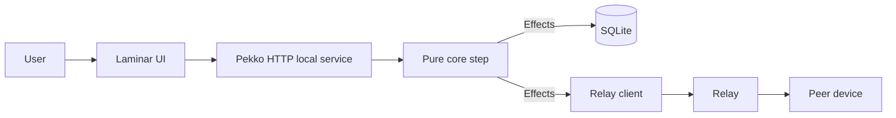

# Plan 0001：YoChat 重写

- 状态: draft
- 日期: 2026-11-20
- 前序: ADR-0001（护栏）、ADR-0002（技术栈）、ADR-0003（v1 范围）、ADR-0004（测试/性能/预算）
- 活规格: `.scratch/yochat-rewrite/spec.md`
- 约束来源: `docs/evaluations/2026-11-20-yochat-postmortem/` 与 `docs/evaluations/2026-11-20-cfa-session/`

## 规模与交付边界

用户要的是「加好友，单聊」这一句话，加上落盘、重启、断网重连。下表按功能域而不是旧规格的 93 条需求计数；旧规格是后续版本的输入，不是本计划的基线。

| 维度 | 用户要的 | 本计划产出 | 倍率 | 说明 |
| --- | --- | --- | --- | --- |
| 功能域 | 3（加好友、单聊、落盘/重连） | 3 | 1× | 不把发布级需求塞进 S1 |
| 表 | 3（联系人、会话、消息） | 6（+邀请、meta、sessions） | 2× | 邀请与加密会话需要持久化；密钥材料不落明文表 |
| 组件 | 5（core、store、transport、server、UI/shell） | 6（shell 单列） | 1.2× | Electron 只做原生集成 |
| 配置项 | 8 | 16 | 2× | 中继地址、数据目录、锁参数、性能阈值、skip/rekey/retired-ratchet 上限 |
| 工程师日 | 20（估算） | 25–35（估算） | 1.25–1.75× | 含 spike 与测试移植；不含 S2 |
| 发布波次 | 1 | 1 | 1× | S1 一次交付 |
| Quint 模型 | 旧 144（复盘口径；当前检出 170） | 5 | 0.03× | 只建模保留的一条协议路径 |
| 生产代码 | 旧约 250k 行 | ≤30k 行 | 0.12× | 硬预算，不是愿望 |

不要用「旧项目有 93 条需求」来论证本计划需要更多；那正是复盘里的范围放大。

本表按功能域计数；40 条 S1 需求/不变量的逐条映射见 `test-parity.md` 与下文的「S1 不变量落点」，不用本表替代不变量清单。

## 状态与前序

- 旧实现已完成两轮（2026-09-18 整体重写、第一版未建模后重做）；本计划的整体重写是第三次，也是最后一次（Y7）。
- 旧实现只读在 `~/projects/yochat-reference`；需求快照在 `docs/spec/`。
- 本计划只做 S1；S2（多设备）与 S3（发布级）另立计划。
- 技术栈与旧 `technology-stack.md` 不同，由 ADR-0002 取代；v1 范围由 ADR-0003 收窄。

## 背景与缺口

旧实现的功能停在加好友与单聊，但代码约 25 万行，协议层持续修到 11 月 20 日。主要缺口不是「功能没写完」，而是：

- 范围：发布级需求与自用场景混在一起；
- 结构：模块边界不按变更频率切；旧实现生产代码最大 6,008 行（`handshake.rs`），测试最大 13,373 行；5,454 是 CFA 的 `SessionEntity.scala`，不是 YoChat；
- 验收：完成判据是 AI 自述，不是固定场景；
- 协议：去中心化 + 加密 + 异步的组合没有收到一条可验证的路径。

本计划先把 S1 的两台设备路径跑通，再谈多设备。

## 目标

1. 两个用户、每个用户各一台设备，完成邀请/应答加好友。
2. 单聊消息先落盘再发送；按作者顺序应用，去重；缺失时等待并重发。
3. 双方重启不丢消息；断网后重连继续。
4. 安全门：签名验证、密文篡改拒绝、重放拒绝、密钥分离。
5. 性能门与测试门进 `./check.sh`，回执存数值。
6. 交付物可被一个人读懂：生产 ≤30k 行、模块 ≤8k 行、文件 ≤2k 行。
7. S1 安全不变量按 ADR-0003 的不可删清单落地；只保证同一作者顺序，GBNV 不在 v1。

## 非目标与已知约束

- 多设备同步、新设备历史同步、设备吊销传播：S2。
- 跨作者最终全序（GBNV）：S2；S1 只保证同一作者顺序，T1 标记为不等价。
- 群聊、文件传输：后续版本。
- 恢复短语、四设备迁移接管：后续版本。
- 联系人删除/拉黑：S3；不在 S1 的 14 条行为契约里。
- 完全 p2p / NAT 打洞：v1 是 relay-only（ADR-0002）。
- 发布级 WCAG 审计、十万条首屏 500ms：S3。
- 没有中继时，跨网两台设备不能通信。这是 v1 的已知约束。
- 中继可见端点、时间、字节数；内容端到端加密。这是 v1 的已知暴露面。

S1 的安全与生命周期不变量不接受「删掉明天还能发消息」这条功能判据；不可删清单见 ADR-0003。

### S1 不变量落点

40 条需求的完整测试映射见 `test-parity.md`；下表只列 round-1 评审发现缺少设计落点的 11 条，给出设计位置与验证入口。

| 需求 | 设计落点 | 验证 |
| --- | --- | --- |
| `B9Y4E73VMQ8RS99X` 应用锁是安全边界 | `State.lock`（locked/unlocked + generation）；`Lock` 事件递增代数；旧代数的在途结果不落地 | `E2E#13`、`SM-app-lock` |
| `YQW27DXZJSHAR0Z0` 空闲超时自动锁定 | `State.idleDeadline`；`IdleTimeout` 事件走同一条锁定路径 | `E2E#13`、`SM-idle-lock` |
| `865PCSHV46Q4X2XF` 密钥不进日志/崩溃报告 | 执行器统一日志脱敏；核心不产生可记录正文、密钥、联系人名或公钥的日志事件 | `E2E-log-secrets`、`UT-log-redaction` |
| `DVFN7QEAWP32QD9G` 诊断默认不记录内容 | 诊断默认级别与内容边界；正文、联系人标识、公钥默认不写 | `E2E-diagnostics-content` |
| `2276A5JCK1KGNS1A` 邀请签名并绑定发起方账号 | 定向邀请；A 的渠道标签/权威账号进入邀请载荷并由用户私钥签名 | `Q1`、`UT-invite-signature` |
| `YP7HYFDC5BSKK1BP` 邀请/应答绑定双方权威账号 | `contacts` 记录双方渠道标签/账号；`invitations.peer_account`；不符进待确认并标记 | `Q1`、`SM-reply-verify` |
| `A1MZYZ7JV43G7EJ3` 应答方发出应答即完成本方确认 | B 发出应答即完成本方确认并进入待确认；A 在第一条经认证操作后确认；过期+宽限后降级并提示重新交换 | `E2E#1/#2`、`Q1` |
| `KWW858WDBR49C9KS` 拒绝应答不产生信号 | 拒绝只删本地待确认项，不产生 `Send`/`Notify` | `SM-reject-silent` |
| `HYREM42TB44CYAHF` 无匹配记录的入站丢弃 | 入站先按联系人与邀请匹配；无匹配直接丢弃 | `SM-admission`、`UT-inbound-discard` |
| `RYGFPP529TDA9R6X` 不与未建立关系的对端交换消息 | 关系门在准入层；未建立关系不产生应用层响应 | `SM-admission`、`E2E#9` |
| `MXHYRG96W0VKB031` 未授权请求不产生响应 | 未授权请求静默丢弃；不产生错误回包或通知 | `SM-inbound-gate` |

## 设计

### 组件



- `shell/`：Electron 主进程，负责窗口、通知、钥匙串、单实例、启动/停止 JVM 服务。它不持有业务状态。
- `server/`：Pekko HTTP 本地服务，绑定回环；UI 通过 HTTP/WebSocket 调用；执行器把 `Effect` 落到 `store/` 与 `transport/`。
- `core/`：纯状态机与协议 ADT；不依赖 Pekko、JDBC、UI。
- `store/`：SQLite；消息、联系人、会话、邀请、meta。
- `transport/`：中继客户端；连接、重连、帧边界、有界队列。
- `relay/`（可独立部署）：最小 WebSocket 转发服务；只转发密文与路由信息。

### 状态机

```scala
def step(state: State, event: Event): (State, Vector[Effect])
```

- `State` 只含纯数据：身份、联系人、会话、消息索引、待发/待确认集合、邀请、定时器身份、连接状态、加密会话状态（root/rekeyBase/ratchet/chain/skipped/retiredDh/rekey）、`lock`（locked/unlocked + generation）、`idleDeadline`、待确认关系。
- `Event`：用户动作、网络到达、定时器到期、对端可达性变化、效果完成/失败、`Lock`/`Unlock`/`IdleTimeout`、邀请过期。
- `Effect`：`Persist`、`Send`、`StartTimer`、`RequestRandom`、`Notify`。核心不产生包含正文、密钥、联系人名或公钥的日志事件；执行器统一脱敏。
- 执行器负责：状态与效果同事务提交、效果幂等、稳定定时器身份、出站前重查授权；锁定事件递增 `lock.generation`，旧代数的在途结果不落地。
- 核心不读时钟、不取随机数、不做 IO。时间与随机数作为事件输入。

### 数据模型（v1）

| 表 | 关键列 | 说明 |
| --- | --- | --- |
| `contacts` | `user_pub`, `channel_label`, `channel_account`, `peer_channel_account`, `alias`, `note`, `safety_verified`, `confirmation_state`, `created_at` | 联系人；双方各自记录渠道/账号；`safety_verified=false` 时禁止发送/呈现正文 |
| `conversations` | `id`, `peer_user_pub`, `created_at`, `last_applied_seq` | 一对一；每个用户各一台设备 |
| `messages` | `id`, `conversation_id`, `session_id`, `author_pub`, `device_pub`, `seq`, `body`, `wire`, `state`, `created_at` | `wire` 是完整 `header || ct || sig`，重发原样使用；`(session_id, device_pub, seq)` 唯一；`seq` 每作者每会话、跨 rekey 不重置 |
| `invitations` | `id`, `ephemeral_priv`, `peer_account`, `expires_at`, `state`, `confirm_state`, `payload` | 一次性私钥只留在签发设备；过期/作废后删除；不符账号进待确认 |
| `sessions` | `id`, `peer_user_pub`, `peer_device_pub`, `state`, `state_version`, `generation`, `updated_at` | `state` 加密后存 root/rekeyBase/ratchet/chain/skipped/retiredDh/rekey；`state_version` 防回滚 |
| `meta` | `key`, `value` | schema 版本、计数器、配置快照、锁配置 |

密钥材料不放在明文表：用户私钥/设备私钥/数据库密钥由系统钥匙串或口令派生保护；`sessions.state` 整体加密，具体存储机制由 ADR-0007 决定。

### 协议路径（S1）

1. **邀请**：S1 只做定向邀请。A 用用户私钥签名，携带 A 的用户公钥、A 的设备公钥、A 的渠道标签与权威账号、有效期、一次性公钥（同时是邀请 id）。邀请是文本，可粘贴到任何渠道。
2. **应答**：B 生成自己的用户/设备密钥，用 A 的一次性公钥加密应答，签名覆盖整份邀请摘要与 B 的全部声明；B 的渠道标签/账号与 A 的声明进入载荷。只有 A 能解开。
3. **建立关系**：A 解对应答，核对双方渠道账号；不符进待确认并标记。双方核对安全码（带外、人工）；`safety_verified=false` 前不发送/不呈现用户正文，只允许控制/rekey。B 在发出应答时完成本方确认；A 在第一条经认证操作后确认；邀请过期+宽限后降级并提示重新交换。拒绝应答只删本地待确认项，不产生任何信号。
4. **单聊**：消息先落盘，再经中继发送；接收方先验签，再按 `(session_id, device_pub, seq)` 去重、解密、按 `author_pub + seq` 排序。入站先按联系人与邀请匹配；无匹配或未授权请求静默丢弃，不产生应用层响应。
5. **等待/重发**：缺失消息时显示「等待」，由接收方在时限后请求重发；发送方在无确认时兜底重发。两者都有上限。
6. **通道重建**：解密失败时由接收方发起重建并重传未确认消息；超过上限才告知用户。
7. **断网重连**：连接状态变化是 `Event`；重连后有界重放未确认消息。

S1 每个用户各一台设备，协议按「两成员组」建模；S2 扩展到多成员时沿用同一成员语义，不另写一套。S1 只保证同一作者顺序；跨作者最终全序（GBNV）在 S2，T1 标记为不等价。

### 加密与密钥（S1，ADR-0006）

A-first 不能直接用 Rust 的 p2panda 群棘轮。ADR-0006 已接受 S1 的最终方案：**Signal Double Ratchet 两方子集**；spike 只证明原语/传输，不把对称 hash chain 当生产实现。

- 原语：JDK 25 JCE 的 Ed25519、X25519、ChaCha20-Poly1305；HKDF-SHA256 用本地 RFC 5869 实现（已由 A-first harness 验证）。BouncyCastle 只用于 JCE 缺少的算法（如 Argon2id）或经过审查的备选；不手写原语。
- 会话密钥：root chain + 两条方向链；DH ratchet、`N`/`PN`、有界 skipped keys、每条消息唯一 message key；具体 KDF/初始 ratchet/消息 header/rekey 见 ADR-0006。
- D2：ADR-0006 已列出 JVM ratchet/Noise 候选与拒绝理由；没有自包含、宽松许可、无外部服务的现成 Double Ratchet。
- 数据库：`sessions.state` 整体加密；SQLCipher/JDBC 或应用层 AEAD 由 ADR-0007 决定；密钥来自系统钥匙串或口令派生（Argon2id）。
- 测试向量：邀请/应答签名、初始 root、ratchet/乱序/重放、密文/签名篡改、密钥分离、安全码、rekey、重启。
- 安全论证：前向保密、DH ratchet 后的 break-in recovery、后加入者读不到旧消息（S1 单设备不涉及，但方案不能堵死 S2）、失败即拒绝。

实现按 ADR-0006；外部密码学评审是发布门。旧 `encryption-scheme.md` 是参考，不是 S1 的既成方案；旧 `conversation-as-device-group.md` 的成员语义保留，群棘轮实现推迟到 S2。

### UI（三屏）

1. **解锁/身份**：创建或解锁本地身份；显示本机设备名。锁定、解锁与空闲超时由 `State.lock`/`idleDeadline` 驱动；锁定后旧代数的在途结果不显示。
2. **联系人**：列表；加好友（粘贴邀请/应答）；显示安全码；待确认、账号不符、邀请过期/作废有独立状态。
3. **聊天**：会话、消息列表、输入框；等待/重发/重建状态只显示为状态，不显示为错误。

不做旧文档里额外长出来的界面功能；新增一屏需要单独提案。

## 测试规格等价

按 ADR-0004 的 T1：

- Quint：邀请交换（Q1）、消息排序/去重（Q2）、等待/重发（Q3）、重连（Q4）、通道重建（Q5）。目标 5 个模型，不是 144；KEEP/DROP 映射见 `test-parity.md`。
- Scala 属性/状态机：同生成器、同性质、同参考模型；真实 SQLite 事务与崩溃重启。`identity_creation.qnt` 与 `idle_autolock.qnt` 没有 5 个模型槽位，走 Scala 属性并在 `test-parity.md` 逐条签字。
- 行为契约：14 个 E2E 场景（见 `docs/agents/verification.md`）；联系人删除/拉黑已移出 S1，#12 改为日志/诊断内容边界。
- 单元测试：按新结构重写；不追求覆盖率。
- `test-parity.md` 在实现计划里逐条登记旧测试；省略/弱化必须写理由并人签字。GBNV 标记为 S2 不等价，不静默忽略。
- Kani 无 Scala 等价物：登记缺口，用属性测试补足或人工裁决。

## 性能门

| 指标 | 阈值 | 方法 |
| --- | --- | --- |
| 1,000 条端到端 | <5s | 两台本地进程，固定数据与种子，中位数；A-first named gate，不校准 |
| 冷启动 | p50 ≤2s / p95 ≤4s | 含 Electron 壳的 shell spike，进程启动到 UI 可交互；只校准一次 |
| 空闲内存 | ≤800MB | 空闲 5 分钟后，JVM + Electron 合计；shell spike，不校准 |

指标进 `./check.sh` 与回执；文档数字不是门。1,000 条 <5s 与 ≤800MB 不由 spike 失败后放宽；只有冷启动阈值按 ADR-0004 校准一次。

## Spike（先于实现）

| Spike | 时间盒 | 通过条件 | 失败动作 |
| --- | --- | --- | --- |
| A-first 传输 + 邀请/应答 + 对称链 harness | 5 人日 | relay-only 传输，两个独立 client JVM；100 条消息 + 重连；1,000 条 <5s；邀请/应答签名、E2E、重放/篡改拒绝、密钥分离；无 Rust 依赖 | 只有这些 named gate 失败才写 ADR 切 B（iroh/p2panda sidecar） |
| SQLCipher/JDBC 或应用层 AEAD | 2 人日 | 真实 SQLite 落盘、重开可读；密钥不以明文出现；1,000 次插入 + 1,000 次按会话读取 p95 <2s；`EXPLAIN QUERY PLAN` 无全表 blob 扫描 | 选应用层 AEAD；两者都不行则升级存储设计 |
| Electron ↔ JVM 生命周期/钥匙串/IPC | 2 人日 | 单实例、启动/停止、钥匙串读写、通知；不含 JavaFX WebView fallback（ADR-0002 已否决） | 调整壳方案；若无可行壳，开新 ADR，不静默改栈 |
| Laminar 列表（1k 条） | 1 人日 | 1,000 条消息滚动 frame p95 ≤16.7ms；输入到上屏 p95 ≤50ms（参考机、固定数据） | 调整虚拟列表/渲染方案 |
| 性能基线（含壳） | 1 人日 | 冷启动 p50/p95 与空闲内存有可重复测量脚本；1,000 条 <5s 复用 A-first 回执 | 只校准冷启动一次并写回 ADR-0004；硬门失败走对应 spike 决策，不静默放宽 |

spike 的产物是代码、测量记录与 ADR，不是「调研结论」。没有通过 spike 的模块不进入实现。最终两方 ratchet/前向保密是 M1 的方案 gate，不是 A-first 传输 spike 的通过条件；ratchet 失败不等于 JVM/relay 路线失败。

## 风险

1. **两方 ratchet/前向保密**：最高风险，但它是单独的方案 gate。ADR-0006 已做 D2 复用分析并选定 Signal Double Ratchet 两方子集；若实现或外部评审无法满足，重新设计或用新 ADR 再评估 B，不把失败记成 JVM/relay 路线不可行。
2. **SQLCipher/JDBC 不可用**：应用层 AEAD 是备选；再不行则升级存储设计。
3. **Electron + JVM 资源与生命周期**：shell spike 先验证；冷启动只校准一次，内存与 1,000 条门不放宽。
4. **relay-only 改变产品叙事**：v1 明确写「没有账号服务器，但有一个中继」；不宣称完全 p2p。
5. **测试移植工作量**：T1 限制在行为契约与领域不变量；按功能分批，不追全量。
6. **范围回潮**：任何新增功能必须过 ADR-0003 的三问；删不掉就不进。删除判据只删功能，不删 ADR-0003 的 S1 安全不变量。

## 里程碑

- M0 约束与计划（本提交）。
- M1 spike + ADR-0006（加密）、ADR-0007（存储，如需）。
- M2 core 状态机 + 5 个 Quint 模型 + 对拍。
- M3 store + transport + relay + 邀请/应答。
- M4 UI 三屏 + Electron 壳。
- M5 E2E 行为契约 + 性能门 + test-parity。
- M6 合入、清理工作树、更新 impl。

## 取代的旧文档

- `docs/spec/engineering/decisions/technology-stack.md` → ADR-0002。
- 旧产品文档的 v1 范围 → ADR-0003（仅 v1；旧文档仍是后续版本输入）。
- 旧 `encryption-scheme.md` 的群棘轮实现 → S2；S1 方案由 ADR-0006 决定。
- 旧 `docs/plans/` 不取代：它们是历史，不是需求。

## 验收

1. 两个用户、每个用户各一台设备完成邀请/应答加好友，安全码可比对；双方渠道账号不符时进待确认。
2. 互发 100 条消息，顺序正确、无重复；双方重启后仍在；S1 只保证同一作者顺序，GBNV 不在 v1。
3. 断网、重连，未确认消息继续送达。
4. 篡改密文/签名/重放被拒绝；应用锁、空闲锁定、日志/诊断无秘密、入站准入按 ADR-0003 的不可删清单落地。
5. 14 条 E2E 行为契约全绿；性能回执含三个指标；`test-parity.md` 无未签字省略。
6. 生产代码 ≤30k 行、测试 ≤15k 行、最大文件 ≤2k 行、最大模块 ≤8k 行。
