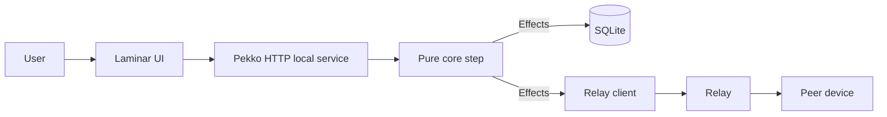

# Plan 0001：YoChat 重写

- 状态: draft
- 日期: 2026-11-20
- 前序: ADR-0001（护栏）、ADR-0002（技术栈）、ADR-0003（v1 范围）、ADR-0004（测试/性能/预算）
- 活规格: `.scratch/yochat-rewrite/spec.md`
- 约束来源: `docs/evaluations/2026-11-20-yochat-postmortem/` 与 `docs/evaluations/2026-11-20-cfa-session/`

## 规模与交付边界

用户要的是「加好友，单聊」这一句话，加上落盘、重启、断网重连。下表按功能域而不是旧规格的 93 条需求计数；旧规格是后续版本的输入，不是本计划的基线。

| 维度 | 用户要的 | 本计划产出 | 倍率 | 说明 |
| --- | --- | --- | --- | --- |
| 功能域 | 3（加好友、单聊、落盘/重连） | 3 | 1× | 不把发布级需求塞进 S1 |
| 表 | 3（联系人、会话、消息） | 5（+邀请、meta） | 1.7× | 邀请需要持久化；密钥材料不落明文表 |
| 组件 | 5（core、store、transport、server、UI/shell） | 6（shell 单列） | 1.2× | Electron 只做原生集成 |
| 配置项 | 8 | 10 | 1.25× | 中继地址、数据目录、锁参数、性能阈值等 |
| 工程师日 | 20（估算） | 25–35（估算） | 1.25–1.75× | 含 spike 与测试移植；不含 S2 |
| 发布波次 | 1 | 1 | 1× | S1 一次交付 |
| Quint 模型 | 旧 144 | 5 | 0.03× | 只建模保留的一条协议路径 |
| 生产代码 | 旧约 250k 行 | ≤30k 行 | 0.12× | 硬预算，不是愿望 |

不要用「旧项目有 93 条需求」来论证本计划需要更多；那正是复盘里的范围放大。

## 状态与前序

- 旧实现已完成两轮（2026-09-18 整体重写、第一版未建模后重做）；本计划的整体重写是第三次，也是最后一次（Y7）。
- 旧实现只读在 `~/projects/yochat-reference`；需求快照在 `docs/spec/`。
- 本计划只做 S1；S2（多设备）与 S3（发布级）另立计划。
- 技术栈与旧 `technology-stack.md` 不同，由 ADR-0002 取代；v1 范围由 ADR-0003 收窄。

## 背景与缺口

旧实现的功能停在加好友与单聊，但代码约 25 万行，协议层持续修到 11 月 20 日。主要缺口不是「功能没写完」，而是：

- 范围：发布级需求与自用场景混在一起；
- 结构：模块边界不按变更频率切，单文件最大 5,454 行；
- 验收：完成判据是 AI 自述，不是固定场景；
- 协议：去中心化 + 加密 + 异步的组合没有收到一条可验证的路径。

本计划先把 S1 的两台设备路径跑通，再谈多设备。

## 目标

1. 两个用户、各一台设备，完成邀请/应答加好友。
2. 单聊消息先落盘再发送；按作者顺序应用，去重；缺失时等待并重发。
3. 双方重启不丢消息；断网后重连继续。
4. 安全门：签名验证、密文篡改拒绝、重放拒绝、密钥分离。
5. 性能门与测试门进 `./check.sh`，回执存数值。
6. 交付物可被一个人读懂：生产 ≤30k 行、模块 ≤8k 行、文件 ≤2k 行。

## 非目标与已知约束

- 多设备同步、新设备历史同步、设备吊销传播：S2。
- 群聊、文件传输：后续版本。
- 恢复短语、四设备迁移接管：后续版本。
- 完全 p2p / NAT 打洞：v1 是 relay-only（ADR-0002）。
- 发布级 WCAG 审计、十万条首屏 500ms：S3。
- 没有中继时，跨网两台设备不能通信。这是 v1 的已知约束。
- 中继可见端点、时间、字节数；内容端到端加密。这是 v1 的已知暴露面。

## 设计

### 组件



- `shell/`：Electron 主进程，负责窗口、通知、钥匙串、单实例、启动/停止 JVM 服务。它不持有业务状态。
- `server/`：Pekko HTTP 本地服务，绑定回环；UI 通过 HTTP/WebSocket 调用；执行器把 `Effect` 落到 `store/` 与 `transport/`。
- `core/`：纯状态机与协议 ADT；不依赖 Pekko、JDBC、UI。
- `store/`：SQLite；消息、联系人、会话、邀请、meta。
- `transport/`：中继客户端；连接、重连、帧边界、有界队列。
- `relay/`（可独立部署）：最小 WebSocket 转发服务；只转发密文与路由信息。

### 状态机

```scala
def step(state: State, event: Event): (State, Vector[Effect])
```

- `State` 只含纯数据：身份、联系人、会话、消息索引、待发/待确认集合、邀请、定时器身份、连接状态。
- `Event`：用户动作、网络到达、定时器到期、对端可达性变化、效果完成/失败。
- `Effect`：`Persist`、`Send`、`StartTimer`、`RequestRandom`、`Notify`。
- 执行器负责：状态与效果同事务提交、效果幂等、稳定定时器身份、出站前重查授权。
- 核心不读时钟、不取随机数、不做 IO。时间与随机数作为事件输入。

### 数据模型（v1）

| 表 | 关键列 | 说明 |
| --- | --- | --- |
| `contacts` | `user_pub`, `alias`, `note`, `safety_verified`, `created_at` | 联系人；安全码比对是人工结果 |
| `conversations` | `id`, `peer_user_pub`, `created_at`, `last_applied_seq` | 一对一；S1 每方一台设备 |
| `messages` | `id`, `conversation_id`, `author_pub`, `seq`, `body`, `state`, `created_at` | 本地明文正文受数据库加密保护；`state` 为待发/已发/已确认/等待 |
| `invitations` | `id`, `ephemeral_priv`, `expires_at`, `state`, `payload` | 一次性私钥只留在签发设备；过期/作废后删除 |
| `meta` | `key`, `value` | schema 版本、计数器、配置快照 |

密钥材料不放在明文表：用户私钥/设备私钥/数据库密钥由系统钥匙串或口令派生保护；具体形态是 spike。

### 协议路径（S1）

1. **邀请**：A 用用户私钥签名，携带 A 的用户公钥、A 的设备公钥、渠道身份、有效期、一次性公钥（同时是邀请 id）。邀请是文本，可粘贴到任何渠道。
2. **应答**：B 生成自己的用户/设备密钥，用 A 的一次性公钥加密应答，签名覆盖整份邀请摘要与 B 的全部声明。只有 A 能解开。
3. **建立关系**：A 解对应答，双方核对安全码（带外、人工）。双方各自落盘联系人。
4. **单聊**：消息先落盘，再经中继发送；接收方解密、验签、按 `author_pub + seq` 去重与排序。
5. **等待/重发**：缺失消息时显示「等待」，由接收方在时限后请求重发；发送方在无确认时兜底重发。两者都有上限。
6. **通道重建**：解密失败时由接收方发起重建并重传未确认消息；超过上限才告知用户。
7. **断网重连**：连接状态变化是 `Event`；重连后有界重放未确认消息。

S1 只有一台设备，协议按「两成员组」建模；S2 扩展到多成员时沿用同一成员语义，不另写一套。

### 加密与密钥（S1 spike）

A-first 不能直接用 Rust 的 p2panda 群棘轮。S1 的第一项 spike 必须给出：

- 原语：Ed25519、X25519、HKDF-SHA256、ChaCha20-Poly1305（BouncyCastle）；不手写原语。
- 会话密钥：两方 ratchet 的具体方案、每条消息的密钥、乱序窗口、过期与重建。
- 数据库：SQLCipher/JDBC 或应用层 AEAD；密钥来自系统钥匙串或口令派生（Argon2id）。
- 测试向量：邀请/应答签名、密文篡改、重放、密钥分离。
- 安全论证：前向保密、后加入者读不到旧消息（S1 单设备不涉及，但方案不能堵死 S2）、失败即拒绝。

spike 产出 ADR-0005 后才能写消息加密实现。旧 `encryption-scheme.md` 是参考，不是 S1 的既成方案；旧 `conversation-as-device-group.md` 的成员语义保留，群棘轮实现推迟到 S2。

### UI（三屏）

1. **解锁/身份**：创建或解锁本地身份；显示本机设备名。
2. **联系人**：列表；加好友（粘贴邀请/应答）；显示安全码。
3. **聊天**：会话、消息列表、输入框；等待/重发/重建状态只显示为状态，不显示为错误。

不做旧文档里额外长出来的界面功能；新增一屏需要单独提案。

## 测试规格等价

按 ADR-0004 的 T1：

- Quint：邀请交换、消息排序/去重、等待/重发、重连、通道重建。目标 5 个模型，不是 144。
- Scala 属性/状态机：同生成器、同性质、同参考模型；真实 SQLite 事务与崩溃重启。
- 行为契约：约 15 个 E2E 场景（见 `docs/agents/verification.md`）。
- 单元测试：按新结构重写；不追求覆盖率。
- `test-parity.md` 在实现计划里逐条登记旧测试；省略/弱化必须写理由并人签字。
- Kani 无 Scala 等价物：登记缺口，用属性测试补足或人工裁决。

## 性能门

| 指标 | 阈值 | 方法 |
| --- | --- | --- |
| 1,000 条端到端 | <5s | 两台本地进程，固定数据与种子，中位数 |
| 冷启动 | p50 ≤2s / p95 ≤4s | 进程启动到 UI 可交互；首个 spike 后校准一次 |
| 空闲内存 | ≤800MB | 空闲 5 分钟后，JVM + Electron 合计 |

指标进 `./check.sh` 与回执；文档数字不是门。

## Spike（先于实现）

| Spike | 时间盒 | 通过条件 | 失败动作 |
| --- | --- | --- | --- |
| A-first 传输 + 邀请/应答 + 两方 ratchet | 5 人日 | S1 安全门 + 两台设备 100 条消息 + 性能门 | 写 ADR 切 B（iroh/p2panda sidecar） |
| SQLCipher/JDBC 或应用层 AEAD | 2 人日 | 真实 SQLite 落盘、密钥不落明文、查询可用 | 选应用层 AEAD；两者都不行则升级设计 |
| Electron ↔ JVM 生命周期/钥匙串/IPC | 2 人日 | 单实例、启动/停止、钥匙串读写、通知 | 换 JavaFX WebView 或调整壳 |
| Laminar 列表（1k 条） | 1 人日 | 滚动与输入无可感卡顿 | 调整虚拟列表方案 |
| 性能基线 | 1 人日 | 三个指标有可重复的测量脚本 | 校准冷启动阈值并写回 ADR-0004 |

spike 的产物是代码、测量记录与 ADR，不是「调研结论」。没有通过 spike 的模块不进入实现。

## 风险

1. **从零实现两方 ratchet**：最高风险。缓解：只用成熟原语、测试向量、Quint 模型、外部评审；若风险不可接受，切 B。
2. **SQLCipher/JDBC 不可用**：应用层 AEAD 是备选；再不行则升级存储设计。
3. **Electron + JVM 资源与生命周期**：spike 先验证；性能阈值按实测校准一次。
4. **relay-only 改变产品叙事**：v1 明确写「没有账号服务器，但有一个中继」；不宣称完全 p2p。
5. **测试移植工作量**：T1 限制在行为契约与领域不变量；按功能分批，不追全量。
6. **范围回潮**：任何新增功能必须过 ADR-0003 的三问；删不掉就不进。

## 里程碑

- M0 约束与计划（本提交）。
- M1 spike + ADR-0005（加密）、ADR-0006（存储，如需）。
- M2 core 状态机 + 5 个 Quint 模型 + 对拍。
- M3 store + transport + relay + 邀请/应答。
- M4 UI 三屏 + Electron 壳。
- M5 E2E 行为契约 + 性能门 + test-parity。
- M6 合入、清理工作树、更新 impl。

## 取代的旧文档

- `docs/spec/engineering/decisions/technology-stack.md` → ADR-0002。
- 旧产品文档的 v1 范围 → ADR-0003（仅 v1；旧文档仍是后续版本输入）。
- 旧 `encryption-scheme.md` 的群棘轮实现 → S2；S1 方案由 ADR-0005 决定。
- 旧 `docs/plans/` 不取代：它们是历史，不是需求。

## 验收

1. 两台设备（各一个用户）完成邀请/应答加好友，安全码可比对。
2. 互发 100 条消息，顺序正确、无重复；双方重启后仍在。
3. 断网、重连，未确认消息继续送达。
4. 篡改密文/签名/重放被拒绝。
5. `./check.sh` 全绿；性能回执含三个指标；`test-parity.md` 无未签字省略。
6. 生产代码 ≤30k 行、测试 ≤15k 行、最大文件 ≤2k 行、最大模块 ≤8k 行。
