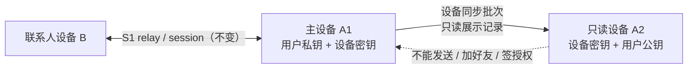

# Plan 0011 design: S2 只读第二设备

- 状态：draft（2026-11-26）
- 范围：S2-A。主设备 A1 保持 S1 对端协议不变；第二台设备 A2 只读，经主设备同步加入后的消息。
- 关联：ADR-0003（v1/S2 范围）、ADR-0004（测试与性能门）、ADR-0006（会话加密）、ADR-0007（存储）、ADR-0008（ACK/窗口）；S1 验收回执见 Plan 0010。
- 直接来源：2026-11-25 `AI体验营` 群消息（本文末列 id）；仓库既有总结 `docs/evaluations/2026-11-25-d-sync-throughput-requirements.md` 与 `docs/evaluations/2026-11-23-tenk-sync-discussion.md`。

## 1. 规模与交付边界

| 维度 | 需求要什么 | 本计划产出 | 倍率 | 说明 |
| --- | ---: | ---: | ---: | --- |
| 需求条数 | 4 | 4 | 1× | 第二台设备、加入后消息、同序不丢、移除设备 |
| 新表 | 0（能复用就不加） | 3 | 不可比 | `devices`、`device_sync`、A2 只读投影 `companion_messages`；A1 仍只有 `messages` 一份 peer 消息 |
| 新列 | 0 | 1 | 不可比 | A1 `messages.sync_seq` 承载可见变更流；A2 用 `companion_messages.sync_seq`，不改 `wire`/session |
| 组件 | 1（server/transport 内） | 3 | 3× | 配对/授权、设备同步、设备管理 UI；三者都在现有进程内，不新增服务 |
| 配置 | 0 用户可调 | 6 个内部常量 | 不可比 | 配对有效期、最多只读设备数、批次大小、在途批次、重试期限、最大批次字节 |
| 工程师日 | 5–8（估算） | 10–15（估算） | 1.9× | 含身份文件 v2、存储迁移、同步协议、Q7 设备同步模型、E2E 与重启/断网测试；不含历史同步 |
| 发布波次 | 1 | 1 | 1× | 与 S1 同一应用交付；不单独发服务 |

三个组件恰好是 3×，解释：A2 不参与对端协议，所以不新增 relay 服务、第二个核心状态机或群棘轮；组件是现有 `server`/`transport`/`ui` 内的三个职责，不是三个新进程。任一项在实现中需要新服务，停止并回到本计划重定范围。

## 2. 状态与前序

- S1 已按仓库定义收尾：100 条双向、重启、断网重连、UI/Electron/跨主机路径均已验收；本地 1k/10k 门与 `./check.sh` 有回执。S2 不重开 S1 的性能门，也不把跨主机 23.5 msg/s 改写成 S1 失败。
- ADR-0003 的 S2 是“同一用户 2 台设备、新设备只读加入后消息、吊销”。本计划实现这个 S2 的第一种最小形态：**主设备 + 只读伴随设备**。
- 本计划**不**实现完整对端可见的多设备：B 不把 A2 当作消息收件人，A2 也不直接与 B 建立会话。这样 S1 的 peer wire、session、ACK/窗口和存储 AAD 不变；A2 通过 A1 得到加入后的消息。
- **S2-A 是部分里程碑，不是完整 S2**：ADR-0003 还把跨作者最终全序（GBNV）和联系人可见的签名吊销放在 S2。S2-A 不实现这两项；A2 只镜像 A1 的本地顺序，移除只是本地停止同步。两项都必须在后续计划关闭，不能把 S2-A 写成“S2 已完成”。
- 冲突检查：若 owner 要求 A2 在 A1 离线时直接收 B 的消息，或要求联系人看到并拒绝 A2，S2-A 不满足；必须改 ADR-0003 并走 S2-B，见 §11。

## 3. 背景与缺口

S1 的数据模型是“一个用户、一台设备”：

- `contacts` 每行只有一个 `devicePub`；
- `sessions` 对应一个 peer device；
- `Conversation` 以 `peerDevicePub` 和每个作者的 `seq` 排序；
- 身份文件 `identity.bin` 同时保存用户私钥和设备私钥，代码假定本机可以签邀请/应答。

A2 只读意味着它不能持有用户私钥、不能签邀请/应答、不能直接解密 A1 与 B 的 ratchet 帧。A2 需要的是**展示副本**：联系人、会话、加入后的消息，以及来源顺序。

群讨论补充了两条边界：

- D 在 11:43–11:50 明确把 1,000 条/秒放在**历史同步**，并说实时消息在他的设计里限到约 600 条/分钟；13:59 又说“只有实时消息必须一条条分开提交”，批量事务只适合历史同步。这个区分与本计划一致：S2 不把历史同步的 1000/s 当实时门，也不为实时路径改批量提交。
- D 在 11:44 问“消息不丢失和所有设备看到的消息顺序一致”。S2-A 的回答是：A2 完全按 A1 的本地提交顺序镜像；它不承诺 B 与 A1 的跨作者全序（GBNV），也不承诺 A1 离线时 A2 能自己收消息。

## 4. 目标

1. A1 生成一次配对码，A2 以设备密钥加入；A1 用用户私钥签发设备授权，A2 不获得用户私钥。
2. A2 从授权时刻起接收 A1 的联系人、会话和消息展示副本；授权前的历史一条不下发。
3. A2 按 A1 当前 UI 的可见顺序（`ApiJson.visible` + `ordered`，即 `(seq, sourceId)`）展示；批次缺失时等待/续传，不跳过、不重复。未补齐缺口的 buffered 行不提前展示。
4. A1 可以移除 A2；移除后不再发送新内容。A2 的既有本地数据保留，未来内容不再到达。
5. 不改变 S1 对端路径；没有 A2 时，S1 的行为、门禁和回执完全相同。

## 5. 非目标与已知约束

### 非目标

- 历史同步；D 的 1 万条/10 秒（约 1,000 条/秒）不在本计划。它是**候选需求，尚未被采纳为 S3 门**；需要 owner 裁范围、单独基准、批量路径和 ADR。
- A2 发送消息、加好友、签设备授权、签吊销声明或修改安全码状态。
- B 直接向 A2 发送、A2 与 B 建立会话、对端可见的完整设备列表。
- 多台只读设备；S2 最多 1 台。
- 群聊、文件、恢复短语、用户私钥同步、远程擦除。
- 跨作者最终全序（GBNV）；A2 只镜像 A1 的顺序。
- UI 重做；D 对 S1 UI 的审美批评不在本计划。
- 实时批量提交、R7 的 CAS/状态缓存改造、UI 全量刷新改造。它们要么属 S1 的已知限制，要么需要单独测量，不塞进 S2。

### 已知约束

- A1 必须在线才能收到 B 的新消息；A2 依赖 A1 的同步，A1 离线时 A2 只看到旧内容。
- A2 只看到加入后的消息；没有历史回填。
- A1 丢失后 A2 不能接管：A2 没有用户私钥，不能签邀请/设备授权，也没有完整的对端会话。S2 没有恢复短语。
- 移除 A2 是本地停止同步，不是联系人可见的签名吊销；A2 已拿到的旧消息不会被远程擦除。
- A2 不直接与 B 通信，因此 B 不会把 A2 当作收件人，也不会因 A2 被移除而改变对 A1 的信任。
- 设备同步使用配对时建立的长期同步根；它不是 Double Ratchet，不提供逐消息前向保密。A2 被攻破时，旧同步数据已经在本机；移除后停止新同步，重新配对会生成新根。此约束必须由 ADR 明确接受。
- A1 的本地消息顺序是 S2-A 的顺序来源；它不证明跨用户全序，也不把 B 的本地顺序强行改成同一顺序。

## 6. 角色与数据流

- **A1（主设备）**：持有用户私钥、A1 设备私钥和 S1 对端会话；继续作为 B 的唯一对端。A1 是 S2-A 的“常在线设备”。
- **A2（只读设备）**：持有自己的设备私钥、用户公钥、A1 签发的设备授权和同步根；不持有用户私钥，不持有 A1/B 的会话状态。
- **B（联系人设备）**：不知道 A2 的存在；仍按 S1 与 A1 通信。



## 7. 配对与授权

### 7.1 A1 生成配对码

A1 的“添加只读设备”生成一次性 `PairingInvite`：

```text
version=1
userPub           32B
primaryDevicePub  32B
ephemeralPub      X25519 32B
nonce             16B
expiresAt         i64（unix ms）
role              companion
signature         Ed25519(userPriv, domain || canonical fields)
```

- 有效期默认 10 分钟；一次性 nonce 由 A1 持久化到 `meta` 的 short-lived row 或内存 + 重启失效；重启后未完成的配对需要重新生成。
- 配对码只包含公钥、nonce、有效期和签名；不包含用户私钥、同步根或联系人信息。
- 中继只看到设备公钥和帧计数；配对码可以经任意渠道复制，但 A2 必须能连到中继。

### 7.2 A2 提交加入请求

A2 生成新的设备密钥和一次 X25519 临时密钥，向 A1 的 `primaryDevicePub` 发送：

```text
PairingRequest {
  pairingNonce
  companionDevicePub
  companionEphemeralPub
  encryptedName
  proof = Ed25519(companionDevicePriv, domain || fields)
}
```

- `encryptedName` 用 X25519(A2 eph, A1 eph) 派生的 request key 加密；中继不解。
- A1 必须验证 `PairingRequest.proof`（A2 设备密钥对请求字段的签名）后才显示；配对码签名/nonce/有效期失败即拒绝。
- 名称和指纹不能只由 A1 屏幕上的请求方提供：A2 必须在自己的屏幕上显示**自己的设备指纹和一个由 `pairingNonce || companionDevicePub` 派生的确认码**；用户在 A1 与 A2 两块屏幕上比对确认码，确认一致后才授权。A1 同时显示接收到的设备指纹；任一不一致即拒绝。
- A1 将 `pairingNonce` 与 `requestHash`（规范化 `PairingRequest` 的 SHA-256）保存在 `devices` 的待确认/已授权行。**同一个 nonce 和同一个 requestHash** 可重发以取回原授权（A2 丢了授权时）；不同 nonce/不同 requestHash 在第一笔确认后拒绝。这样授权丢失可恢复，但不会变成第二个设备。
- A1 不以“名称相同”代替确认码/指纹比对；A2 重发请求时必须仍带原设备密钥的 proof，A1 核对 requestHash 与已授权设备公钥一致。

### 7.3 A1 确认并签发授权

用户在 A1 与 A2 两块屏幕上比对确认码/指纹一致后，在 A1 上确认；A1 用**用户私钥**签发：

```text
DeviceAuthorization {
  version=1
  userPub
  primaryDevicePub
  companionDevicePub
  role=companion
  joinEpoch        u64
  joinManifest     (conversationId, authorPub, devicePub) -> maxSeq
  joinManifestHash 32B
  joinCursorSyncSeq i64
  syncRootHash     32B
  issuedAt         i64
  signature        Ed25519(userPriv, domain || fields)
}
```

- `joinManifest` 是确认时刻 A1 对每个 `(conversationId, authorPub, devicePub)` 的最大**已落盘** `seq`（包含尚未可见的 buffered 行），随 `DeviceAuthorization` 由用户私钥签名；它是**认证过的创建截止线**。A1 只导出不满足 `seq <= manifest[(conversation, author, device)]` 的消息，A2 也用它校验；不使用 `messages.id` 或任何未进入 AAD 的本地行号做安全判断。这样配对前已存在、配对后才变 `Delivered` 的消息仍被排除，即使 A1 的本地行 id 被重排/重标。配对确认后才到达的、此前未落盘的帧按“加入后”处理；这是本计划的边界定义，不声称能重建对方发送时间。
- `joinCursorSyncSeq` 是同一时刻 A1 `messages.sync_seq` 的高水位，仅用作变更流起点，不承担创建边界。两条信息都保存；只用 `sync_seq` 会把配对前消息的状态更新误发给 A2。
- 两端用 X25519 共享秘密和 `joinEpoch` 派生 `syncRoot`；`syncRootHash` 绑定授权与同步根。同步根不经过中继；A2 只从 X25519 共享秘密派生，A1 不把用户私钥发过去。
- A1 在**一个事务**里写 `devices`（授权/名称/`joinManifest`/同步游标/`pairingNonce`/`requestHash`）和 `device_sync`（`syncRoot`/初始游标），锁序 `devices → device_sync`；任一失败则都不提交。授权本身用配对 X25519 request key 派生的 AEAD 加密后再经 relay 发送，relay 不能读到 `userPub`/名称；A2 解密后验证用户签名。A1 自己的 device 条目也由用户私钥签一次自授权，A2 用它验证 A1 的 `DeviceSyncBatch` 签名。
- A2 验证用户签名、`syncRootHash` 和确认码后写入 `devices`，并把自身标记为只读；A2 的 `device_sync` 行保存同一 `syncRoot` 和 `joinCursor`。A2 没有 `device_sync` 就不能进入“已加入”状态。
- 崩溃恢复：授权提交后、A2 收到前崩溃，A1 的 `devices`/`device_sync` 都已存在；A1 可在下次配对请求/重连时重发授权（同一 `joinEpoch`/`syncRoot`），不能生成第二个根。A2 收到旧授权时按 `joinEpoch` 幂等。授权未提交则配对码仍可重试，不留下半授权。
- A2 的身份文件是 v2：`userPub`、设备密钥对、`hasUserPrivate=false`、设备授权摘要；不含用户私钥。A1 的身份文件仍是 v1 或迁移到 v2，`hasUserPrivate=true`。
- A2 的本地存储使用自己的 master/数据库密钥；不共享 A1 的 store key。

### 7.4 配对失败

- 配对码过期、nonce 重放、签名不匹配、用户拒绝、A2 已有非空本地实例：拒绝并清理临时状态。
- 中继不可用：显示“需要中继”，不降级到直连；ADR-0002 仍有效。
- A1 在确认前崩溃：配对码/临时状态可丢；A2 重试必须重新生成配对码，不留下半授权。

## 8. 只读同步

### 8.1 同步内容

A1 把以下记录作为**展示副本**发给 A2：

- 联系人：`userPub`、显示名、安全码状态（只读）、别名/备注；
- 会话：会话 id、对端用户（不包含 A2 不需要的 peer session 细节）；
- 消息：源 `messages.id`、conversation id、author/device、`seq`、正文、`created_at`、状态（Received/Delivered 的展示值）；
- 设备授权摘要（A2 自己与 A1）。

同步源不是 A1 的原始插入行，而是 **A1 当前 UI 的可见投影**：A1 使用与 `ApiJson.visible` 相同的规则过滤，未补齐缺口的 buffered 消息不发；A2 不会先看到 B 的第二条而 A1 还没显示第一条。A1 的可见顺序是 `ApiJson.ordered` 的 `(seq, messages.id)`；A2 按同样的 `(seq, sourceId)` 排序，而不是按插入时间或单纯 `sourceId`。

消息记录是 **upsert**，不是只追加：A1 发出消息后状态从 `Sent` 变 `Delivered`（或 `Failed`）时，A1 生成一条同 `sourceId` 的状态更新记录；A2 按 `sourceId` 覆盖显示状态，不新增消息行。状态更新与新增消息共用 `sync_seq` 流、批次、ACK 和游标；A2 不轮询状态。

`sync_seq` 是 S2 新增的**变更序号**：A1 在消息**首次变为可见**、状态变化或可见顺序变化时，从 `meta["message-sync-seq"]` 取下一个值写入 `messages.sync_seq`。未补齐缺口的 buffered 行不分配 `sync_seq`，也不发送；缺口闭合时，A1 在应用/持久化这批可见消息的同一事务里为它们分配 `sync_seq`。A2 的 `companion_messages.sync_seq` 保存源值；`sourceId` 仍用于消息身份，`sync_seq` 用于重放/续传，两者不能互换。

不发送：peer `wire`、ratchet 状态、session key、用户私钥、A1 的本地密钥、B 的设备私钥。A2 即使拿到全部同步内容，也不能冒充 A1 向 B 发送消息。

联系人/会话是**快照**：没有新消息但联系人/会话变化时，A1 发一个只含快照的批次（`sync_seq` 可不变），A2 照常校验/写入/ACK；由 S1 的联系人写入 hook 触发，不用 timer 轮询。

### 8.2 批次、可见顺序与容量

- A1 读取 `sync_seq > lastAckedSyncSeq`、且按 `ApiJson.visible` 可见的变更；`sync_seq = 0` 的 buffered 行不选。每条消息再用**签名过的 `joinManifest`** 判断 `(conversation, author, device, seq)` 是否在加入前；在加入前的记录（即使后来有新 `sync_seq`/状态更新）不选。状态更新是同一 `sourceId` 的新 `sync_seq` 记录，但创建边界仍由 manifest 决定。
- A2 的消息列表按 `(seq, sourceId)` 升序展示，与 A1 的 `ApiJson.ordered` 一致；状态更新不改变消息位置，只覆盖状态。批次缺失时等待/请求重发，不把后面的批次先显示。
- 一个批次最多 256 条变更，并且编码后的帧必须小于 `RelayPayload.MaxPayload`（1,048,774 字节）。A1 按字节装箱，超长拆批；单条记录本身超长时返回 `SyncRecordTooLarge` 并停止该设备同步，不等 ACK、不无界重试。联系人/会话快照也按字节拆批。
- 批次头包含 `batchSeq`、`prevBatchHash`、`firstSyncSeq`、`lastSyncSeq`；A2 只接受连续的 `batchSeq`，并在一个事务内写入/更新 `companion_messages`、更新 `lastAckedSyncSeq/lastBatchSeq/lastBatchHash`，再返回 ACK。
- A1 不把同步放进 S1 的发送窗口或 ACK 路径；A2 离线不阻塞 A1→B 的实时消息。A1 只保留游标，源消息仍在 SQLite，可重放。
- 重复批次按 `(companionDevicePub, batchSeq)` 幂等；重复消息按 `(companionDevicePub, sourceId)` 幂等。

### 8.3 Relay 载体

现有 `RelayPayload` 只识别 S1 的四种 kind，`AppRuntime.translateInbound` 也会丢弃未知帧；直接把设备同步塞进 S1 `WireFrame` 到不了 A2。S2 新增一个**不透明 relay 载体**：

```text
RelayEnvelope {
  version=1
  kind=device-sync
  fromDevicePub
  toDevicePub
  body             # PairingRequest | DeviceAuthorization | DeviceSyncBatch
                   # | SyncStatusRequest | SyncStatus | ACK | ResyncRequired
}
```

- `relay` 新增 `kind=device-sync` 的路由分支：只校验长度/端点并转发 `body`，不解析、不解密；`RelayClient` 在 `AppRuntime.translateInbound` 之前把该 kind 分派给 `DeviceSyncChannel`，不进入 core 的 S1 frame/session 路径。
- 配对请求/授权、批次、ACK、`SyncStatus` 都走同一载体；不新增第二个 relay 服务、第二个网络协议栈或直连路径。
- 中继需要同批升级；E2E 必须跑真实 relay 往返，不能只用内存 transport。`RelayServerConnection.handle` 的未知 kind 丢弃行为保留，新增 kind 必须显式路由。`DeviceAuthorization` 必须用配对 key 加密；wire fixture 断言 relay 侧字节不含 `userPub`/设备名。
- 这与 S1 `WireFrame` 是两条**用途不同的路径**：S1 路径仍是 peer 消息；`device-sync` 只承载自有设备之间的展示副本。两者共享 relay/client 和有界队列，不共享加密状态。

### 8.4 同步封装

为什么不能直接复用 S1 `WireFrame`：A2 没有 A1/B 的 ratchet 状态和用户私钥；复用 peer wire 只有两条路——把 peer session key 复制给 A2，或让 A2 以用户身份参与握手。前者破坏“只读设备不持有对端会话”，后者要求用户私钥，都会把 S2-A 变成 S2-B。现有 relay/client/有界队列仍复用；新增的只是**自有设备之间的展示副本封装**，不改变 S1 peer 协议。

```text
DeviceSyncBatch {
  version=1
  authHash        32B
  batchSeq        u64
  prevBatchHash   32B
  firstSyncSeq    i64
  lastSyncSeq     i64
  plaintextLength u32
  nonce           12B
  ciphertext      AEAD(batchKey, nonce, records)
  signature       Ed25519(A1 devicePriv, domain || header || nonce || ciphertext)
}
```

- `batchKey = HKDF-SHA256(syncRoot, salt=batchSeq, info="yochat-s2-device-sync/v1", L=32)`；`nonce` 12B 随机，随帧传输，禁止复用。`nonce` 是解密必需输入，不能只留在发送方内存。
- AAD 覆盖 `authHash`、`batchSeq`、`prevBatchHash`、`firstSyncSeq`、`lastSyncSeq`、`plaintextLength` 和 `nonce`。
- A2 先验证 A1 的设备授权和签名，再 AEAD 解密；失败即静默丢弃整批，不推进游标，也不回 `ResyncRequired`（未认证输入不产生应用层响应）。
- A2 的 ACK 用设备私钥签 `(authHash, batchSeq, batchHash)`；A1 验证后才推进 `lastAcked`。
- A2 在连接/重连时发送：

```text
SyncStatus {
  version=1
  authHash
  lastBatchSeq    u64
  lastBatchHash   32B
  lastAckedSyncSeq i64
  signature       Ed25519(companionDevicePriv, domain || fields)
}
```

A2 在连接/重连时主动发 `SyncStatus`；A1 在启动或 relay 重连后也发 `SyncStatusRequest`（A1 设备签名），A2 回复同一 `SyncStatus`。这样 **A1 重启而 A2 保持在线** 时也能恢复，不依赖 A2 重连。A1 验证签名与授权后，选择一个完整的 checkpoint `(lastAckedSyncSeq, lastBatchSeq, lastBatchHash)`，不得把本地游标和 A2 的旧 hash 拼接：只接受比本地更新的 status；相同 `lastBatchSeq` 但 hash 冲突即拒绝并要求重新同步。`status.lastAckedSyncSeq` 不得超过 A1 当前 `meta["message-sync-seq"]`。即使 ACK 丢失、A1 重启、A2 已提交批次，A1 也不需要保存旧批次的 nonce/ciphertext。A1 重算下一批时使用所选 checkpoint 的 `lastBatchHash` 作为 `prevBatchHash`。

### 8.5 离线、重启、缺口

- A2 离线：A1 不建无界内存队列；只记录 `lastAckedSyncSeq`，重连后按 `SyncStatus` 从下一批重放。
- A2 重启：持久化 `lastAckedSyncSeq`、`lastBatchSeq`、`lastBatchHash`；重新连接后主动发 `SyncStatus`，不依赖 A1 记住旧批次。
- A1 重启：从数据库按 `sync_seq` 读可见源行/状态更新；不依赖内存批次。
- 认证后的缺口：A2 只有在校验通过 A1 签名/批次后才发现 `batchSeq` 缺口，才返回签名的 `ResyncRequired`；A1 从 A2 的 `lastBatchHash` 重算。认证失败/未知来源直接丢弃，不响应。
- 超过 `MaxSyncBatchesInFlight=4` 或 `MaxSyncBatchBytes`：A1 停止生成下一批直到收到 ACK/status，不丢源消息；首次批次超长按 §8.2 拆分或失败。
- A1 或 A2 锁定时同步暂停：A1 不解密/不生成新批次，A2 不应用批次；解锁后从 `SyncStatus`/最后游标继续。正文不得因同步写入未加密临时文件或日志。

## 9. 本地移除只读设备

- A1 的“移除设备”在 `devices` 里把 A2 标记 `revokedAt`，递增设备版本，删除 `device_sync` 的同步根和游标；之后不再生成 A2 的批次。
- 不发 `DeviceRemoved` 控制帧：移除后 A1 直接停止同步，A2 没有对端会话，拿不到未来内容；离线 A2 收不到通知也不影响安全边界。A2 UI 只显示最后同步时间，不把“没新消息”变成错误。
- 联系人 B 不收到通知；A2 从不直接与 B 通信。完整设备列表/签名吊销声明是 S2-B 或后续计划，不在本计划冒充。
- A2 的既有本地消息保留；不会远程擦除。A2 被偷时，攻击者能读到已经同步的内容；这是本地静态加密与设备移除的已知边界。
- 移除后重新添加 A2 视为新配对：新 `joinEpoch`、新 `syncRoot`、新 `joinManifest`/`joinCursorSyncSeq`；旧 A2 数据不续传，旧授权不可复活。

## 10. 存储、锁序与迁移

### 10.1 表

| 表/列 | 内容 | 保护 |
| --- | --- | --- |
| `devices` | `device_pub` PK、`user_pub`、`role`、`name`、`authorization`、`version`、`created_at`、`revoked_at`、`join_epoch`、`join_manifest`、`join_manifest_hash`、`join_cursor_sync_seq`、`pairing_nonce`、`request_hash` | `name`/`join_manifest` 按 store key 封存；AAD 绑定 device pub、user pub、version；`join_manifest_hash` 是签名授权的摘要；`request_hash` 支持同一请求重发；高水位 `meta["device-version/<hex>"]` |
| `device_sync` | `peer_device_pub` PK、`sync_root`、`last_acked_sync_seq`、`last_batch_seq`、`last_batch_hash`、`version`、`updated_at` | `sync_root` 封存；AAD 绑定 peer device pub、version、auth hash |
| `companion_messages` | `source_id` PK、`conversation_id`、`author_pub`、`device_pub`、`seq`、`body`、`state`、`created_at`、`sync_seq` | A2 专用只读投影；`body` 用 A2 的 store key 封存，AAD 绑定 source id/conversation/author/device/seq；没有 `wire`/peer session |
| `messages.sync_seq` | A1 可见变更序号 | 明文整数；首次可见/状态/顺序变化时递增；索引 `(sync_seq)` 用于续传 |
| `meta` | `schema_version=3`；设备/消息变更高水位 | 只放整数；不把同步根放进 meta |

不复用 `sessions` 存设备同步：`sessions` 是 A1/B 的 Double Ratchet 状态，A2 不应持有；把同步根塞进 `sessions` 会让 A2 的只读身份与 peer session 语义混在一起。`meta` 按 ADR-0007 只放整数，不能放同步根。

为什么 A2 不直接复用 `messages`：`MessageRepository.decode` 对每一行调用 `WireFrame.parse`，空 `wire` 会返回 `InvalidEnvelope`；`AppStateRestore.contactsFrom` 又假定联系人来自 peer session。把 `wire` 置空或塞一个假 frame 会削弱 S1 的校验，把 peer session 复制给 A2 则违反只读边界。因此 A2 用 `companion_messages` 只读投影：没有 `wire`/session，UI 走专用读取路径；A1 的 `messages` 表仍是唯一 peer 消息源。

A2 的 `companion_messages`：

- `source_id` 直接使用 A1 的 `messages.id`；A2 是新建空实例，不与自己已有消息冲突。
- `conversation_id`、`author_pub`、`device_pub`、`seq`、`created_at`、`state` 来自源记录；`sync_seq` 来自 A1。
- `body` 用 A2 自己的 store key 重新封存；没有 `wire`、没有 `session_id`、没有发送/重发路径。
- A2 的 `ApiJson`/`AppService` 在 `role=companion` 时只读 `companion_messages`，不调用 `MessageRepository.listRecentMessages`；只读门同时在服务端 API 和 UI。
- A2 的 `AppStateRestore` 新增 companion 分支：从 `devices` 判定角色，加载 `contacts`/`conversations` 快照，不要求 peer session；`outgoing` 为空。primary 分支保持原 S1 严格校验，不能因 S2 放宽。

### 10.2 身份文件 v2

- v1：`userPriv || userPub || devicePriv || devicePub`，四把都有。
- v2：增加 `flags` 与可选 `userPriv`；A2 为 `flags=companion`，只存 `userPub || devicePriv || devicePub`、授权哈希。A2 没有用户私钥。
- `LocalIdentity` 增加用户私钥可选/角色字段；调用邀请、应答、设备授权、吊销签名处必须显式检查；A2 返回稳定的 `NotAuthorizedForCompanion`，不生成伪签名。
- A1 的 v1 身份在迁移时写 v2 primary 记录；不重写旧密钥材料。A2 必须是新实例；已有非空实例拒绝配对或使用新的数据目录，不能覆盖原数据。

### 10.3 锁序

S2 的全局顺序在 ADR-0007 的表之间插入 `conversations` 与新增表；原有表相对顺序不变：

```text
invitations → contacts → conversations → sessions → messages
            → devices → companion_messages → device_sync → meta
```

- 配对：单事务写 `devices` → `device_sync` → `meta`；`sync_root` 与授权同事务，失败不留下“有授权无根”的半状态。
- A1 生成批次：读 `messages`/`messages.sync_seq`，读 `devices`，成功后更新 `device_sync`；不在同一事务写 `messages`。
- A1 消息追加/状态变化：先写 `messages`（含 `sync_seq`），再写 `meta`；不持有 `devices`/`device_sync` 锁。
- A2 应用批次：单事务写 `contacts`/`conversations`/`companion_messages`，再写 `device_sync`，最后写 `meta`；顺序 `contacts → conversations → companion_messages → device_sync → meta`。
- 移除设备：写 `devices` + 删 `device_sync` + `meta`，不写 `messages`/`companion_messages`。
- 不嵌套事务；SQLite 单写者约束不变。

### 10.4 迁移

- 当前 `Schema.Version` 是 **2**（1→2 已加 `messages.attempts`）。本计划升到 **3**：保留 1→2 不变，新增 2→3：创建 `devices`、`device_sync`、`companion_messages`，给 `messages` 加 `sync_seq` 默认 0；不新建 `messages.origin`，不改 `wire`/`body`/AAD。
- 2→3 迁移必须用**已有数据的 v2 库**做夹具：旧消息、attempts、WAL；迁移后 S1 消息可读、查询计划不变、`check.sh` 全绿。A1 升级后插入自己的 primary `devices` 行并初始化 `meta["message-sync-seq"]`。
- A2 是全新实例，直接建 schema 3；已有非空实例拒绝配对/使用新目录，不能把旧库伪装成 companion。
- 迁移失败保留旧库并 `UnsupportedSchema` 失败关闭；不允许把 v2 库当 v3 继续写。回退只走备份恢复，不做自动降级。

## 11. 范围裁决：S2-A 与 S2-B

| 方案 | 行为 | 规模 | 取舍 |
| --- | --- | --- | --- |
| **S2-A（本计划）** | A1 主设备 + A2 只读镜像；A2 不直接与 B 通信 | 3 表、1 列、3 职责、10–15 人日 | 保留 S1 对端协议；最快可用；A1 离线则 A2 停更 |
| S2-B | 联系人可见设备列表；B 向 A1/A2 分发；A2 可直接收；签名吊销传播；GBNV | 4–6 表、对端控制帧、多会话扇出、15–25 人日 | 语义完整，但改 peer 协议/模型/存储；不是本计划 |

本计划选择 S2-A，因为 ADR-0003 把 S2 定义为“新设备只读加入后消息”，且 S1 的对端协议已经冻结。若 owner 要求 A2 在 A1 离线时也能直接收 B 的消息，或要求联系人看到并拒绝 A2，则 S2-A 不满足，必须先改 ADR 并另立 S2-B；不能在本计划里静默加对端扇出。

## 11.1 实施顺序（先设门，再写代码）

1. **ADR-0010（1–2 人日）**：冻结身份文件 v2、`DeviceAuthorization`/`DeviceSyncBatch`、同步根安全边界、本地移除语义。没有 ADR 不写生产代码。
2. **Spike（2–3 人日）**：A1/A2 两进程完成配对、一个批次的加密/签名/ACK、A2 只读写入；A2 无用户私钥的负向断言。Spike 不写产品表，只验证协议与身份边界。
3. **Q7 设备同步模型（1–2 人日）**：配对授权、批次重放/重复、游标续传、移除；不改 Q1–Q6，模型变更单独签字；模型冻结先于生产 worker。
4. **存储迁移（1–2 人日）**：`devices`/`device_sync`/`companion_messages`/`messages.sync_seq`，schema 2→3，查询计划；用已填充 v2 夹具验证；旧 S1 测试全绿。
5. **同步 worker + UI（3–4 人日）**：批次、可见投影、游标、状态 upsert、联系人快照、A2 只读门、移除。
6. **E2E/性能（1–2 人日）**：S2#1–S2#5，1k 同步，S1 回归；回执进 `tmp/checks/` 与本计划的 `impl.md`（实现后创建）。1k 门在完成存储/worker 原型后测，spike 不替它下结论。

第 2 步失败（配对不安全、A2 无法只读）就停在 spike，不带病进入产品代码。1k 同步门在第 6 步用实际存储/worker 拓扑测量；失败就停在 S2，不把阈值放宽，也不先用 UI 掩盖。

## 12. 测试规格等价

- S1 的 T1 映射、E2E#1–#18 和行为契约不变；A2 不存在时，所有 S1 测试按原样运行。
- S2 不是“没有旧测试”：Plan 0001 的 T1 清单已有 enrollment approval、ordered offline catch-up、keyless signing restrictions。映射见本计划 `test-parity.md`；未关闭前不能宣布 S2 交付。
- S2 新增 `S2#1`–`S2#5`，不删除、不弱化 S1 断言。T1 明细和签字状态见 `test-parity.md`。
- 不新增 peer wire kind；`DeviceSyncBatch` 是自有设备之间的新封装，不进入 S1 的 `WireFrame`。S2 新增 **Q7 设备同步模型**，覆盖配对授权、批次重放/重复、游标续传和移除；Q1–Q6 不改。Q7 模型变更单独一轮并签字，不能顺手改模型。
- 若实现时把同步改成 B 可见的 peer 协议，Q7 不覆盖它，必须先改 ADR/模型范围并另立 S2-B。
- A2 的只读门必须同时有 UI 断言和服务端 API 断言；只测 UI 不算。

## 13. 性能与行为门

| Gate | 场景 | 阈值 | 证据 |
| --- | --- | --- | --- |
| S1 回归 | 无 A2；既有 1k/10k、UI、空闲内存 | 原阈值不变 | `./check.sh` 回执 |
| S2#1 功能/可见性 | A1/A2/B 三进程；A1 先有 50 条旧消息；A2 加入后，B 的下一对有效帧先投递 `seq=N+2`、再投递 `seq=N+1`；再 A1/B 各发 100 条 | 从 A1/A2 的 `/api/conversations/<id>/messages` 取加入后范围，A2 序列与 A1 相同；缺口未闭合前不显示 `N+2`；旧消息 0 条；无重复 | `S2#1` E2E 回执，比较实际 history JSON，不只比较 DB hash |
| S2#2 1k 同步 | A1→B 1k + A1→A2 同步；A2 与 A1 同机两进程；真实 relay | A2 收到 1,000 条且 `<=5s`；A1→B 的 1k 门不回退；首个批次不超 `RelayPayload.MaxPayload` | `S2#2` 回执，含 warmup、计数、耗时 |
| S2#3 ACK 丢失/重启 | A2 提交一批后 ACK 丢失；A1 重启而 A2 保持在线、状态更新；另测 A2 重连与旧 status 重放 | A1 发 `SyncStatusRequest`，用 A2 的完整 checkpoint 恢复；相同 batchSeq/hash 冲突拒绝；无重复/缺口；状态更新仍到达；A1→B 不被阻塞 | `S2#3` |
| S2#4 移除 | A1 移除 A2，A1/B 继续发 | A2 不再收到新消息；A1/B 正常；重启后仍如此 | `S2#4` |
| S2#5 安全/恢复 | A2 无用户私钥；配对确认码不一致；授权丢失后同一 request 重发；伪造授权/批次/ACK/未认证帧；加入前消息在加入后才 Delivered 或本地 id 被重标；relay 字节扫描；A2 重启并重开 Received/Sent/Delivered/Failed 行 | 不能签邀请/授权；篡改/未认证输入静默丢弃；旧消息 0 条、重标 id 也不泄漏；relay 不含 `userPub`/设备名；状态更新不泄漏正文；contact-only restart 可读；重开不重发 | `S2#5` + `store.test` |

- 1k 同步 5s 是新增门，不是把 S1 的 5s 门放宽或复用；首次实现若失败，先优化同步路径，不改阈值。确需改阈值，单独 ADR 并由人签字。
- 空闲内存仍按单实例 ≤800MB 记录；A1+A2 合计只作观测，不把 800MB 变成双实例合计门。
- D 的 10k 历史 10s / 1000 条/秒是**候选需求，尚未采纳为 S3 门**；不能用本计划的 1k 实时同步回执冒充，也不能写成已接受门。

## 14. 失败模式与安全边界

| 场景 | 行为 |
| --- | --- |
| 配对码过期/重放 | 拒绝；不生成授权；不落 A2 设备行 |
| 用户拒绝确认 | 丢弃请求；不通知 B；A2 无授权 |
| A2 已有本地数据 | 拒绝配对；要求新数据目录，禁止覆盖 |
| 未认证/签名失败的帧 | 静默丢弃；不返回 `ResyncRequired`；不落盘、不推进游标 |
| 已认证批次缺批 | 只有校验通过的 A2 才返回签名 `ResyncRequired`；A1 从 `lastBatchHash` 重算 |
| 批次超过 relay 上限 | 按字节拆批；单条超限 `SyncRecordTooLarge` 失败，不等待 ACK |
| A2 长时间离线 | A1 只保留游标；源消息在库；重连按 `SyncStatus` 重放；不无界排队 |
| A1 崩溃 | A2 等 A1 重启；授权/游标持久化；重连 `SyncStatus` 恢复；不重复显示 |
| A2 崩溃 | 从 `lastAckedSyncSeq/lastBatchHash` 继续；幂等 |
| 配对前消息在配对后变 Delivered | 按签名 `joinManifest` 的 `(conversation, author, device, seq)` 完全排除；A2 不收到该消息的正文或状态更新 |
| A1 移除 A2 | 停止同步；A2 看不到新内容；旧内容保留 |
| A1 丢失 | A2 不能接管；无用户私钥/恢复短语，失败关闭 |
| A2 被偷 | 已同步内容可见；移除后未来内容不再到达；无远程擦除 |
| 中继不可用 | 配对/同步失败并提示；不直连、不降级 |

安全不变量：

- 用户私钥只在 A1；A2 的任何路径都不能导出或代签。
- A2 不能解密 B 的 peer 帧；同步记录是 A1 解密后的展示副本，重新用 A2 的 store key 封存。
- 设备授权由用户私钥签名；同步批次由 A1 设备私钥签名；A2 的 ACK 由 A2 设备私钥签名。
- 设备名、联系人名、正文不进入日志、错误消息或指标 label。
- 移除 A2 后，A1 不再生成其批次；旧 `device_sync` 根删除；旧授权不能复活。

## 15. UI 验收

- A1：设备管理入口显示“本机（主设备）”“只读设备 A2”、最后同步时间、配对码/确认页、移除按钮；移除需二次确认。
- A2：首屏显示“只读设备 · 跟随 <主设备名>”；聊天可读、可选择复制；输入框/发送/加好友/安全码确认按钮禁用并解释原因；同步中断显示等待状态，不显示为错误。
- 不新增“所有功能一页”；沿用 S1 三屏，设备管理是设置页的一部分。
- UI 用服务端推送，不用 timer 轮询网络帧；S1 的全量刷新限制仍存在，S2 不把它冒充已修。
- 验收只写屏幕、按钮、状态、文案；线程/暂停点/并发交错进实现测试，不占 UI 验收。

## 16. 待裁决（实现前必须由人确认）

1. **S2-A 还是 S2-B**：本计划推荐 S2-A；若要求 A2 在 A1 离线时直接收 B 的消息，或联系人可见设备列表/签名吊销，则必须改 ADR-0003 并走 S2-B。
2. **S2-A 是否算 S2 交付**：本计划是部分里程碑，GBNV 与联系人可见签名吊销仍未关闭；owner 必须明确接受“S2-A 交付后 S2 仍有两项开放”，或改走 S2-B。
3. **“吊销”的口径**：S2-A 只做本地移除；是否接受“联系人看不到 A2、因此不需要对端吊销声明”这一收窄。
4. **同步根安全**：接受“配对长期根 + 每批 HKDF，无逐消息前向保密”；若不接受，先补设备同步 ratchet 的 ADR 与测试，工期增加。
5. **身份文件 v2**：A2 无用户私钥的身份格式与 `LocalIdentity` 扩展，需在实现前固化为 ADR-0010。
6. **1k 同步 5s**：由第 6 步用实际存储/worker 拓扑测量；spike 只验证配对/只读边界，不对 1k 下结论。失败先优化而不是放宽；若硬件/拓扑不成立，单独立 ADR 改阈值。

## 17. 取代的旧文档

- 本计划**不取代** ADR-0003、ADR-0004、ADR-0006、ADR-0007、ADR-0008；它只在 ADR-0003 的 S2 范围内新增一个**部分**实现计划，明确保留 GBNV 与签名吊销两项未关闭。
- 不取代 `docs/spec/product/`；旧 spec 中的历史同步、完整设备列表、联系人可见吊销仍是后续输入。
- 不取代 `docs/evaluations/2026-11-25-d-sync-throughput-requirements.md`；该文保留 D 的 1000/s 历史同步要求，本计划明确不把它当 S2 门。
- 与 `docs/plans/2026/11/0001-yochat-rewrite/design.md` 中“S2 扩展到多成员时沿用同一成员语义/群棘轮到 S2”的实现提示相比，本计划选择更小的 companion 形态；该提示不是 ADR 范围，S2-B 另行计划。若 owner 认为该提示已是承诺，先修正本计划的范围声明，再实施。

## 18. 验收

固定场景（实现后执行）：

1. A1 与 B 完成 S1 关系，A1 先有 50 条旧消息（A1/B 双向）；其中一条在 A2 加入后才从 `Sent` 变 `Delivered`，用于验证创建截止线。
2. A1 生成配对码，A2 在**自己的屏幕**显示确认码/指纹；A1 与 A2 比对一致后确认。A2 本地 `companion_messages` 为 0，联系人可见，输入禁用；伪造/替换的加入请求不能获得授权。
3. A1/B 各发 100 条加入后消息；B 的下一对有效帧先投递 `seq=N+2`、再投递 `seq=N+1`，A1 在缺口闭合前不显示 `N+2`；从 A1/A2 的 `/api/conversations/<id>/messages` 取加入后范围，A2 与 A1 相同，恰好 200 条、无旧消息、无重复。
4. A2 离线，A1/B 再发 20 条；A2 重连后先发 `SyncStatus`，从最后 ACK 续传，顺序与 A1 一致。再制造 ACK 丢失，保持 A2 在线并重启 A1；A1 发 `SyncStatusRequest`，用 A2 的完整 checkpoint 继续，验证不等 A2 重连也能恢复。
5. 重启 A1、A2、B；A2 仍显示完整加入后范围，不重复；A2 的 contact-only 数据可恢复；A1 仍可正常收发。
6. A1 移除 A2；A1/B 再发 20 条，A2 不再收到；重启后仍不再收到。
7. A2 尝试发送/加好友/签授权，服务端与 UI 都拒绝；A2 的本地文件不含用户私钥；未认证的 relay 帧不产生应用响应。

命令（实现后）：

```sh
./mill server.e2e          # S2#1–S2#5；扩展现有 E2E 套件
./mill store.test          # devices/device_sync/companion_messages/messages.sync_seq
./mill server.test         # role-aware ApiJson/AppStateRestore
./check.sh                 # 构建 server/transport assembly 并运行 shell/ui-smoke.js；
                           # 同时是 S1 回归门；回执写 tmp/checks/
```

`test-parity.md` 的 T1 行必须由 owner 签字；未签字前不能把 S2 写成完成。

本计划当前只写了设计，没有实现；上述命令尚未运行，不能写成 PASS。

## 19. 群消息依据与数据边界

- 读取路径：0x1 微信镜像只读查询，群 `AI体验营`（`conversation_id=57253483893@chatroom`），时间为 Asia/Shanghai；不读原始微信库，不修改镜像。
- 关键消息：
  - `133750` 11:43：D 问“消息传输速度没到 1000+/s？这是实时还是历史？”
  - `133758` 11:44：D 问“怎么做到消息不丢失和所有设备看到的消息顺序一致”；`133759` 回答 S1 不包含。
  - `133773` 11:50：D 说“你这是按批发，其实相当于历史消息同步了。实时消息我的设计里是限流成一分钟不超过 600 条”。
  - `133905` 13:20：D 提接收端定时器与历史同步未到 1000 条/秒；`133908` 13:23 明确“每天累积 1w 行，同步 10 秒还行”。
  - `133913`–`133916`：D 判断网络不是瓶颈、一条一个事务抗不住；这些是对方自述，不是本仓实测。
  - `133949`–`133973`：D 要求网络事件驱动、传输与 UI 剥离、状态内存缓存；本计划保留这些方向，但不重启 S1 已通过的事件驱动路径。
  - `134023` 13:59、`134026`/`134028`：D 明确批量事务只适合历史同步，实时消息必须逐条提交；实时限流约 600 条/分钟。
  - `133955`/`134003`：D 说本仓实现“比 sol 强太多”“都没踩”他列的坑；这是对本仓的正面判断，不升级为验收。
  - `134295` 16:11、`134310` 16:25：本人要求报告 S1 进度并说推进慢；镜像在此后没有群消息。
- 数据缺口：本次查询的群消息最后一条是 `2026-11-25 16:25:01`，镜像全局最后一条是 `2026-11-25 17:04:40`；`0x1-wechat-collector` 于 `2026-11-25 17:05:18` 失败停止，2026-11-26 没有镜像消息。因此本文不能声称收集到“11-26 的讨论”；11-26 的最新内容需要先恢复采集或由用户提供，不在本文编造。
- 隐私：只保留群昵称/公开消息 id；省略 wxid、无关聊天与个人标识。

## 20. 自检

- D1 规模表已填；组件 3× 已解释，没有新增服务。
- D2 复用 A1 `messages`/`contacts`/`sessions`/store key；A2 用只读 `companion_messages` 而不是伪造 wire/session，原因见 §10。新增 `devices`/`device_sync`/`companion_messages` 有明确缺口，不另造核心运行时。
- D3/D4 无默认关闭功能的迁移/KPI 协议；无 GA 表。
- D5 只做 companion；S2-B、历史同步、群聊、文件均非目标。
- D6 依赖 A1、无历史、无远程擦除、无联系人可见吊销均写成已知约束。
- D7 锁序已写；`conversations`/新增表插在原有表之间，`device_sync` 在 `meta` 前。
- D8 用户私钥不复制到 A2；签名/AEAD 失败即拒绝；未用安全名义加 outbox/协调层。
- D9 设备名/联系人名/正文不进入日志；同步输入按不可信帧校验。
- Y1 不改 S1 范围；S2-A 是 ADR-0003 的**部分**增量，GBNV/签名吊销未关闭。
- Y2 不改 S1 peer 协议与 Q1–Q6；S2 新增 Q7 设备同步模型，单独签字。
- Y3 3 表/1 列/3 职责/10–15 人日，低于 S1 总量；没有新增第二套运行时。
- Y4 性能门见 §13；S1 门不放宽；1000/s 不混入。
- Y5 S1 T1 不变；S2 的 T1 映射见 `test-parity.md`，未签字的省略不算关闭。
- Y6 取代关系见 §17；D 的 1000/s 留在 evaluation，不写成 S2 门。
- Y7 没有整体重写；S1 代码只做设备/同步增量。
- Y8 本计划是“自用工具”的 S2 规划；方法沉淀另记，不混为验收。
